# sonar_investigacion

**Resumen.** Clasificamos el tipo de buque (Cargo, Passengership, Tanker, Tug) a partir del
ruido que radia, en el subconjunto público de DeepShip (63 grabaciones, 43 buques). De cada
segmento de 3 s se extraen el LOFAR (líneas tonales) y el DEMON (ritmo de la hélice), y se
comparan 7 modelos entrenados desde cero: una regresión logística, una CNN, un transformer y un
híbrido CNN + transformer, estos tres sin y con aumento de datos. La evaluación es una validación
cruzada repetida 5 × 5 por buque, con la configuración elegida sin mirar test y comparaciones con
la prueba de Nadeau y Bengio. Ningún modelo es significativamente mejor que la regresión
logística (F1 macro 0,331 frente a un azar de 0,242). Y como la clase coincide con la época de
grabación, no se puede afirmar que ningún modelo reconozca la firma del buque.

**La métrica: F1 macro.** Para cada clase, el F1 combina cuántos de sus segmentos acierta el
modelo (*exhaustividad*) y cuántas de sus predicciones de esa clase son correctas (*precisión*);
el **F1 macro** es la media de las 4 clases, de modo que todas pesan igual aunque tengan menos
datos (Tug tiene muchos menos que Cargo). Va de 0 a 1 (1 es acertar todo), y aquí el azar es 0,24.
Es la cifra con la que se elige y se compara todo.

```
WAV → control de calidad → preprocesado → LOFAR y DEMON → 7 modelos → validación cruzada 5 × 5 → informe
```

Informe completo, con todas las cifras: [docs/report.md](docs/report.md).

## Contenido

- [Datos y señal](#datos-y-señal): [los datos](#los-datos) · [LOFAR y DEMON](#qué-son-lofar-y-demon) ·
  [un buque real](#un-buque-real)
- [Protocolo de evaluación](#protocolo-de-evaluación-validación-cruzada-5--5)
- [Los modelos por dentro](#los-modelos-por-dentro) · [Por qué cada configuración](#por-qué-cada-configuración)
- [Resultados](#resultados): [resumen](#resumen-de-resultados) y las 15 gráficas explicadas
- [Conclusiones](#conclusiones)
- [Puesta en marcha](#puesta-en-marcha): [requisitos](#requisitos) · [instalación](#instalación) ·
  [comprobar la instalación](#comprobar-la-instalación) · [datos](#descargar-los-datos) ·
  [rasgos](#control-de-calidad-y-rasgos) · [comprobación rápida](#comprobación-rápida-de-los-resultados) ·
  [informe](#regenerar-el-informe) · [reproducir todo](#reproducir-los-resultados-opcional-solo-gpu)
- [Limitaciones](#limitaciones) · [Procedencia](#procedencia) ·
  [Equipo de referencia](#equipo-de-referencia) · [Carpetas](#carpetas) · [Licencia](#licencia) ·
  [Cita](#cita)

## Datos y señal

### Los datos

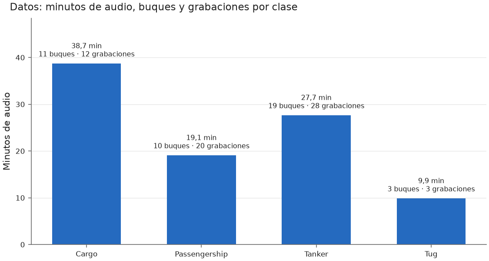

**Todas las grabaciones de DeepShip tienen un barco sonando**: no hay ninguna de solo mar. Esto
marca qué se puede medir:

- **ROC de detección** (la típica de sonar): responde a "¿hay un barco o solo ruido de fondo?".
  Pd es la fracción de grabaciones con barco en las que el sistema avisa, y **Pfa la fracción de
  grabaciones de solo mar en las que avisa sin haber barco** (falsas alarmas). Necesita
  grabaciones sin barco, así que con DeepShip **no se puede medir**.
- **ROC de clasificación** (la que se hace aquí, gráfica 15): da por hecho que hay un barco y
  pregunta "¿es de esta clase?". Se hace una curva por clase, por ejemplo Tug frente al resto:
  **Pd** es la fracción de segmentos de Tug que el modelo reconoce como Tug, y **Pfa** la fracción
  de segmentos de **otras clases** (Cargo, Passengership, Tanker) que confunde con Tug. Nunca mide
  falsas alarmas ante mar vacío: mide confusiones entre tipos de barco.

**Las cuatro clases de buque:**

- **Cargo:** buque de carga (portacontenedores, graneleros). Grande, con motor diésel lento y
  hélice grande.
- **Passengership:** buque de pasaje; en este subconjunto son sobre todo transbordadores (ferris).
- **Tanker:** petrolero o buque cisterna, que transporta líquidos a granel.
- **Tug:** remolcador. Pequeño pero muy potente; empuja o arrastra a otros barcos.

**Entrenamiento, validación y test.** Con *entrenamiento* aprende el modelo; con *validación* se
eligen sus ajustes; *test* se reserva para medir el resultado final sin haberlo usado antes. La
partición se hace siempre **por buque**: si el mismo barco estuviera en entrenamiento y en test, el
modelo podría reconocer *ese barco concreto* en vez de su tipo, y el resultado saldría inflado.

**Cómo se lee.** Cada barra son los minutos de audio de una clase, con sus buques y sus
grabaciones encima. En total, 95 minutos de 63 grabaciones de 43 buques. Destacan el
desequilibrio (Cargo tiene casi el doble de audio que Passengership, y cuatro veces el de Tug) y
que **Tug solo tiene 3 buques**, una sola grabación de cada uno.

### Qué son LOFAR y DEMON

Un sonar pasivo no emite nada: solo escucha con un hidrófono el ruido que radia el barco. Ese
ruido lleva dos tipos de información, y cada técnica extrae uno:

- **LOFAR** (*Low Frequency Analysis and Recording*) muestra qué frecuencias suenan y cómo
  evolucionan en el tiempo. Sirve para ver las **líneas tonales**: sonidos de frecuencia fija que
  produce la maquinaria (motor, generadores, bombas).
- **DEMON** (*Detection of Envelope Modulation On Noise*): la hélice produce un ruido ancho por
  **cavitación** (burbujas que colapsan), y ese ruido "late" al ritmo de la hélice. DEMON mide a
  qué ritmo late, lo que revela la velocidad del eje y el número de palas.


**Qué significan 440 Hz y 12 Hz.** Son pruebas con señales sintéticas cuya respuesta se conoce de
antemano. Un tono de 440 Hz (la nota *la*) escondido en ruido debe aparecer como un pico justo
en 440 Hz en el LOFAR, lo que comprueba que el eje de frecuencias es correcto. Un ruido que
"late" 12 veces por segundo, como lo haría una hélice, debe dar un pico en 12 Hz en el DEMON. La
línea discontinua marca la frecuencia conocida: si el pico cae sobre ella, el procesado es
fiable.

### Un buque real


Una grabación de un Passengership (el MALASPINA).

- **LOFARgram (arriba).** En horizontal, la frecuencia (0 a 2000 Hz); en vertical, el tiempo
  hacia abajo; el color indica cuánto sobresale cada frecuencia del ruido de fondo, en dB. Las
  **líneas verticales** son líneas tonales: frecuencias que se mantienen en el tiempo (aquí,
  hacia 80, 594 y 682 Hz) y que funcionan como una "huella" de la maquinaria del barco.
- **DEMON (abajo).** En horizontal, la frecuencia de modulación (0 a 100 Hz). El pico hacia
  2,8-3 Hz y su doble (5,7 Hz) son el **ritmo del eje** (unas 170-180 vueltas por minuto). La
  serie cada 11,3 Hz (11,3, 22,7, 34, 45,3...) es el **paso de pala** y sus **armónicos**: un
  armónico es un múltiplo entero de una frecuencia base. Como 11,3 / 2,8 ≈ 4, sugiere una hélice
  de **4 palas**.

Estos son los rasgos que un clasificador debería aprender para distinguir buques: qué líneas
tonales tiene cada barco y a qué ritmo late su hélice.

## Protocolo de evaluación: validación cruzada 5 × 5

Se comparan **7 modelos**: una línea base (regresión logística) y, sin y con aumento de datos,
una CNN, un transformer y un híbrido CNN + transformer. **Todos se entrenan desde cero** con
estos datos: ninguno está preentrenado. El diseño completo se fijó por escrito **antes de ver
ningún resultado** ([registro de decisiones](DECISIONS.md)).

Una **partición** es un reparto de los buques entre entrenamiento, validación y test. Aquí hay
**25**. Los 43 buques se reparten al azar en 5 grupos por clase, con buques enteros y minutos
equilibrados. En cada vuelta, un grupo es test, otro validación y los otros tres entrenamiento
(60/20/20), y se rota hasta que cada buque ha estado una vez en test. Se repite 5 veces con
repartos distintos: **25 particiones**, y cada buque de Cargo, Passengership y Tanker cae en test
5 veces. Tug solo tiene 3 buques, así que en todas las particiones va 1 a test, 1 a validación y
1 a entrenamiento, y cada Tug cae en test 8 o 9 veces (regla fijada antes de entrenar).

- **Elección:** cada modelo prueba sus configuraciones con la semilla 0 en las 25 particiones y
  se queda con la de mejor F1 medio de **validación**. Test no interviene en ninguna elección.
- **Modelo final:** la configuración elegida, con 3 semillas por partición; se promedian sus
  probabilidades.
- **Comparación:** con el F1 macro de test de cada partición y la prueba t corregida de Nadeau y
  Bengio, que tiene en cuenta que las particiones comparten buques. Hay 13 comparaciones fijadas
  de antemano, con corrección de Holm por hacerlas a la vez.

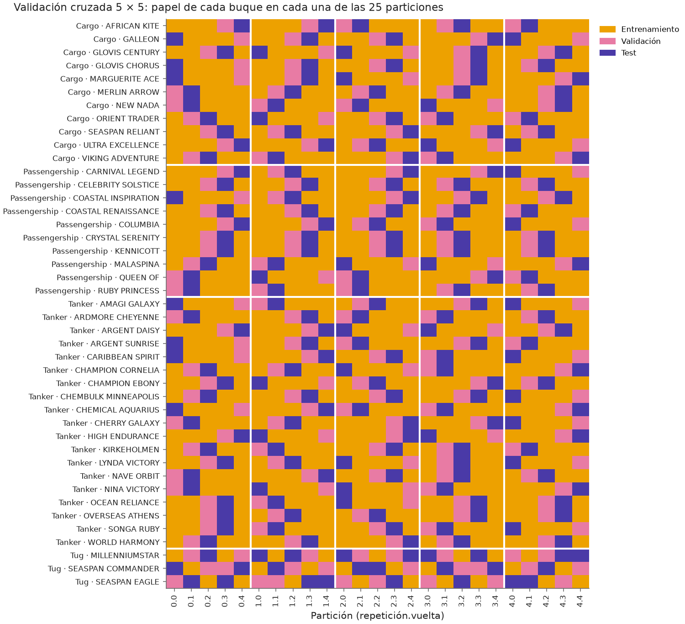

**Cómo se lee.** Una fila por buque, agrupados por clase, y una columna por partición (5
repeticiones × 5 vueltas). El color dice qué papel tiene ese buque en esa partición:
entrenamiento, validación o test. En cada repetición, cada buque de Cargo, Passengership y
Tanker pasa una vez por test y una por validación; los 3 Tug rotan 1/1/1.

**Por qué así (literatura):**

| Referencia | Qué aporta a esta decisión |
|---|---|
| Kohavi (1995) | La validación cruzada estratificada es el método recomendado para elegir modelo; 10 folds es el estándar clásico. Aquí se usan 5 para poder repartir entrenamiento, validación y test 60/20/20 y que Tug (3 buques) quede siempre en entrenamiento. |
| Dietterich (1998) | Comparar algoritmos exige repetir con particiones distintas (prueba 5×2cv), porque mide la variación debida a qué datos tocan en entrenamiento. |
| Bouckaert y Frank (2004) | Un resultado es poco replicable si depende de la partición concreta; proponen repetir la validación cruzada (10×10). |
| Kim (2009) | Con el mismo cómputo, la validación cruzada repetida estima mejor que el *hold-out* repetido (Monte Carlo) y que el bootstrap: por eso rotar y no solo sortear particiones. |
| Bengio y Grandvalet (2004) | La varianza de la validación cruzada se subestima si se tratan los folds como independientes. |
| Nadeau y Bengio (2003) | Prueba t corregida para remuestreo, que tiene en cuenta ese solapamiento: la que se usa para comparar modelos. |
| Varma y Simon (2006) | Elegir hiperparámetros e informar con la misma validación es optimista: aquí se elige con validación y se informa con test, que no interviene en la elección. |
| Bouthillier et al. (2021) | La variación por partición de los datos pesa más que la de la semilla: más particiones antes que más semillas. |
| Hashemi et al. (2026), *UniqueShip* | En sonar pasivo hay que partir por buque; usan 5 repeticiones con buques disjuntos, y al quitar las fugas en DeepShip el F1 cae de ~0,70 a ~0,56. |

Referencias:

- Kohavi, R. (1995). A study of cross-validation and bootstrap for accuracy estimation and model
  selection. *IJCAI*, 1137-1145. [dblp](https://dblp.uni-trier.de/rec/conf/ijcai/Kohavi95.html)
- Dietterich, T. G. (1998). Approximate statistical tests for comparing supervised classification
  learning algorithms. *Neural Computation*, 10(7), 1895-1923.
  [Semantic Scholar](https://www.semanticscholar.org/paper/Approximate-Statistical-Tests-for-Comparing-Dietterich/22f0579f212dfb568fbda317cba67c8654d84ccd)
- Bouckaert, R. R. y Frank, E. (2004). Evaluating the replicability of significance tests for
  comparing learning algorithms. *PAKDD*, LNCS 3056.
  [Springer](https://link.springer.com/chapter/10.1007/978-3-540-24775-3_3)
- Kim, J.-H. (2009). Estimating classification error rate: Repeated cross-validation, repeated
  hold-out and bootstrap. *Computational Statistics & Data Analysis*, 53(11), 3735-3745.
  [RePEc](https://ideas.repec.org/a/eee/csdana/v53y2009i11p3735-3745.html)
- Bengio, Y. y Grandvalet, Y. (2004). No unbiased estimator of the variance of K-fold
  cross-validation. *JMLR*, 5, 1089-1105.
  [JMLR](https://www.jmlr.org/papers/volume5/grandvalet04a/grandvalet04a.pdf)
- Nadeau, C. y Bengio, Y. (2003). Inference for the generalization error. *Machine Learning*,
  52, 239-281. [Springer](https://link.springer.com/content/pdf/10.1023/a:1024068626366.pdf)
- Varma, S. y Simon, R. (2006). Bias in error estimation when using cross-validation for model
  selection. *BMC Bioinformatics*, 7, 91.
  [resumen](https://transferlab.ai/refs/varma_bias_2006/)
- Bouthillier, X. et al. (2021). Accounting for variance in machine learning benchmarks.
  *MLSys*.
  [MLSys](https://proceedings.mlsys.org/paper_files/paper/2021/file/0184b0cd3cfb185989f858a1d9f5c1eb-Paper.pdf)
- Hashemi, C., Stout, T., Hoogs, A. y Parham, J. (2026). UniqueShip: Mitigating data leakage in
  acoustic ship classification benchmark datasets. arXiv:2609.13659.
  [arXiv](https://arxiv.org/html/2609.13659)

## Los modelos por dentro

Todos los modelos ven lo mismo de cada segmento de 3 s: el **LOFARgram** (11 instantes × 1001
frecuencias de 2 Hz, de 0 a 2000 Hz) y el **DEMON** (301 frecuencias de modulación, de 0 a
100 Hz). Antes de entrar en una red, cada entrada se normaliza con la media y la desviación de
**su partición de entrenamiento**; esos dos números se guardan con los pesos.

### Línea base: regresión logística

Ve un resumen de cada segmento: el LOFAR promediado en el tiempo y el DEMON, 1302 números, cada
uno estandarizado. Aprende un peso por número y clase (5212 parámetros) y da la probabilidad de
cada clase. `C` es la inversa de la regularización: cuanto más pequeño, más se frenan los pesos
para que no memoricen. Usa pesos por clase para compensar el desequilibrio.

### CNN: dos ramas convolucionales

Una **red convolucional** aprende pequeños filtros que recorren la entrada buscando patrones
locales, como una línea tonal o un pico de modulación, estén donde estén.

```
LOFARgram 11 × 1001 ─► 3 bloques 2D ─► media en el tiempo ─► 8 posiciones ─┐
DEMON 301 ───────────► 2 bloques 1D ───────────────────────► 8 posiciones ─┴► cabeza ─► 4 clases
```

- **Bloque convolucional:** convolución → **BatchNorm** → **LeakyReLU** → *max pooling*.
  - **BatchNorm** normaliza la salida de cada filtro con la media y la desviación del minibatch.
    Estabiliza y acelera el entrenamiento.
  - **LeakyReLU** es la no linealidad: deja pasar los valores positivos y multiplica los
    negativos por 0,01, para que ninguna neurona quede "muerta" del todo.
  - El *max pooling* se queda con el máximo de cada grupo de frecuencias, solo a lo largo de la
    frecuencia. Reduce el tamaño y tolera pequeños desplazamientos.
- **Rama LOFAR:** filtros de 3 instantes × 7, 5 y 3 frecuencias, con 16, 32 y 64 filtros
  (configuración A). La frecuencia se reduce de 1001 a 250, 62 y 31 posiciones. Después se hace
  la media en el tiempo y se agrupa en 8 posiciones de frecuencia.
- **Rama DEMON:** dos bloques 1D de 16 y 32 filtros (núcleos de 7 y 5); 301 → 75 → 18 → 8
  posiciones.
- **Cabeza:** une las dos ramas (768 números) → *dropout* → capa lineal de 64 → LeakyReLU →
  *dropout* → 4 clases. El **dropout** apaga al azar una fracción de las neuronas en cada paso de
  entrenamiento, para que la red no dependa de ninguna en concreto.
- Tamaño: 79 076 parámetros y 75,3 MFLOPs por segmento (millones de operaciones de coma flotante
  para clasificar un segmento: mide el coste de cálculo).

### Transformer: bandas de frecuencia como palabras

Un **transformer** trata la entrada como una secuencia de **tokens** (como las palabras de una
frase) y aprende, con la **atención**, qué tokens deben mirar a qué otros. Aquí cada token es una
banda de frecuencia: el modelo puede relacionar, por ejemplo, una línea a 50 Hz con su armónico
a 100 Hz aunque estén lejos.

```
LOFARgram ─► 50 bandas de 40 Hz (11 × 20 valores) ─► lineal ─┐
DEMON ─────► lineal ──────────────────────────────────────────┼► [clase, DEMON, 50 bandas] = 52 tokens
token de clase (aprendido) ───────────────────────────────────┘
      ─► N bloques transformer ─► RMSNorm ─► token de clase ─► dropout ─► lineal ─► 4 clases
```

- **Tokens:** el LOFARgram se corta en 50 bandas de 40 Hz (20 frecuencias × 11 instantes = 220
  valores; se descarta la última frecuencia, la de 2000 Hz). Una capa lineal convierte cada banda
  en un vector de tamaño `dim` (32 o 64). El DEMON entero es un token más. El **token de
  clase** es un vector que se aprende; no viene de la entrada, y su salida es la que decide la
  clase, porque por la atención "resume" a todos los demás.
- **Bloque transformer (pre-norm):**

  ```
  x = x + Dropout(Atención(RMSNorm(x)))
  x = x + SwiGLU(RMSNorm(x))
  ```

  Las sumas son **conexiones residuales**: cada bloque añade una corrección a lo que ya había,
  lo que facilita entrenar. *Pre-norm* significa que se normaliza antes de cada parte, la forma
  más estable.
- **RMSNorm:** divide cada token por la raíz de la media de sus valores al cuadrado y lo
  multiplica por una ganancia aprendida. Es más simple que LayerNorm (no resta la media) y
  funciona igual de bien.
- **Atención:** cada token produce una *consulta* (qué busca), una *clave* (qué ofrece) y un
  *valor* (qué aporta). El parecido entre consulta y clave, normalizado con *softmax*, decide
  cuánto toma cada token de los valores de los demás. Hay varias **cabezas** que lo hacen en
  paralelo, cada una pudiendo fijarse en una relación distinta.
- **RoPE** (*rotary position embedding*): sin información de posición, la atención no sabría qué
  banda es cuál. RoPE **gira** las consultas y las claves un ángulo proporcional a la posición de
  la banda (0 a 49), y así el parecido entre dos bandas depende de **su distancia en
  frecuencia**: la misma relación vale a 100 Hz que a 1000 Hz. El DEMON y el token de clase no
  tienen posición en frecuencia y no se giran. (Un test comprueba que el resultado solo depende
  de la distancia.)
- **GQA** (*grouped-query attention*): las cabezas comparten las claves y los valores por grupos.
  Con 4 cabezas y 2 grupos, cada pareja de cabezas usa las mismas claves y valores. Ahorra
  memoria y cálculo; con tantos grupos como cabezas es la atención clásica (también lo comprueba
  un test). Con estos datos no mejora la precisión: se incluyó porque el modelo está pensado para
  usarse con un dataset mucho mayor, donde sí ahorra memoria y cálculo.
- **SwiGLU:** la red que procesa cada token tras la atención: `W_down(SiLU(x·W_gate) ⊙ (x·W_up))`.
  Una rama decide cuánto deja pasar (la "puerta", con la activación SiLU) de lo que calcula la
  otra. Su tamaño interno es unas 8/3 veces `dim` (88 con `dim` 32 y 176 con 64): así tiene los
  mismos parámetros que la red clásica de 4 × `dim`.
- **Tamaño de la configuración elegida (B):** `dim` 64, 1 bloque, 4 cabezas y 2 grupos. Tiene
  80 068 parámetros y cuesta 6,9 MFLOPs por segmento, 11 veces menos que la CNN.

### Híbrido: la CNN como extractor y el transformer encima

Une lo mejor de cada uno: la CNN detecta patrones locales (líneas, picos) y el transformer los
relaciona entre sí a lo largo de la frecuencia.

```
LOFARgram ─► 2 primeros bloques de la CNN (16 y 32 filtros) ─► media en el tiempo
          ─► 62 posiciones de frecuencia × 32 canales ─► lineal ─► 62 tokens ─┐
DEMON ─────► rama 1D de la CNN (16 y 32 filtros) ─► 8 posiciones ─► lineal ─► 1 token ─┼► 64 tokens
token de clase ───────────────────────────────────────────────────────────────────────┘
      ─► bloques transformer como los del transformer ─► token de clase ─► 4 clases
```

- Cada token de frecuencia cubre unos 32 Hz: es la salida de la CNN en esa posición, que ya
  "ve" una zona algo más ancha por los filtros.
- RoPE gira estos 62 tokens según su posición en frecuencia; el DEMON y la clase, no.
- Configuración elegida sin aumento: B (`dim` 64, 1 bloque, 4 cabezas, 2 grupos), con 76 132
  parámetros y 57,3 MFLOPs. Con aumento: A (`dim` 32, 1 bloque, 2 cabezas, 1 grupo), con 32 036
  parámetros. Con un solo grupo, todas las cabezas comparten claves y valores: es el caso
  extremo de GQA, llamado *multi-query attention*.

### Cómo se entrena (igual en las tres redes)

| Técnica | Qué hace | Valor |
|---|---|---|
| **AdamW** | Optimizador que adapta el paso de cada peso según la historia de sus gradientes, con el *weight decay* separado del gradiente | betas 0,9 y 0,999 |
| ***Weight decay*** | Empuja los pesos hacia 0 en cada paso, para que no crezcan solo para memorizar | Según la configuración; nunca en sesgos, normalizaciones ni el token de clase |
| **Minibatches** | Cada paso usa 32 segmentos barajados (con un generador fijo: mismo orden con y sin aumento) | 32 |
| **Pérdida con pesos por clase** | Entropía cruzada que pesa más las clases con menos segmentos | Pesos de la partición de entrenamiento |
| **Calentamiento del lr** (solo transformer e híbrido) | El *learning rate* sube en línea recta desde el 10 % durante las primeras épocas (ver abajo por qué solo en estas dos redes) | 5 épocas |
| **Decaimiento del lr** (*ReduceLROnPlateau*) | Si el F1 de validación pasa 3 épocas sin mejorar, en la siguiente divide el lr por 2 (en transformer e híbrido, tras el calentamiento) | × 0,5 |
| **Parada temprana** | Para si el F1 de validación no mejora en 10 épocas y se queda con los pesos de la mejor época | Hasta 60 épocas |
| **Aumento de datos** (versiones "+ aum.") | Solo en entrenamiento, cada cosa con probabilidad 0,5: tapar 1-2 bandas del LOFAR (hasta 100 Hz), tapar 1-2 instantes, desplazar 1-2 instantes en círculo y tapar una banda del DEMON (hasta 3,3 Hz). Se tapa con la media de entrenamiento | Generador propio |
| **Determinismo** | Semillas fijas, algoritmos deterministas y 4 hilos de CPU: el mismo entrenamiento da los mismos pesos bit a bit en el mismo tipo de dispositivo | — |

**Por qué el transformer y el híbrido tienen calentamiento y la CNN no:**

- Al empezar, los pesos son aleatorios y AdamW todavía no tiene una buena estimación de cuánto
  varía cada gradiente: sus primeros pasos son grandes y poco fiables (Liu et al., 2020, el
  artículo de RAdam).
- En un transformer eso es especialmente peligroso, porque la atención usa un *softmax*: un
  paso grande al principio puede hacer que cada token se fije solo en otro y se quede
  "atascado". Por eso el transformer original (Vaswani et al., 2017) y casi todos los
  posteriores usan calentamiento. El híbrido lo lleva por su parte de transformer.
- La CNN tiene BatchNorm después de cada convolución (Ioffe y Szegedy, 2015), que estabiliza
  las activaciones desde la primera época, y no tiene *softmax* internos. Las CNN se entrenan
  bien sin calentamiento, y es lo habitual.
- Además, la configuración A de la CNN es la CNN de partida, diseñada antes de esta evaluación,
  que no tenía
  calentamiento: si se lo hubiéramos añadido, no sabríamos si un cambio en el resultado venía de
  la red o del calentamiento.

Referencias:

- Vaswani, A. et al. (2017). Attention is all you need. *NeurIPS*.
  [arXiv](https://arxiv.org/abs/1706.03762)
- Liu, L. et al. (2020). On the variance of the adaptive learning rate and beyond. *ICLR*.
  [arXiv](https://arxiv.org/abs/1908.03265)
- Ioffe, S. y Szegedy, C. (2015). Batch normalization: Accelerating deep network training by
  reducing internal covariate shift. *ICML*. [arXiv](https://arxiv.org/abs/1502.03167)

## Por qué cada configuración

Cada red prueba 4 configuraciones, fijadas antes de entrenar. Cada una responde a una pregunta
concreta: **¿qué falla, la capacidad o la regularización?** En las pruebas previas, la CNN memorizaba
(entrenamiento casi perfecto, validación pobre). La primera configuración es siempre la más
simple, y en caso de empate gana ella. La versión sin aumento y la versión con aumento eligen por
separado. Abajo, el F1 medio de validación de cada configuración en las 25 particiones (en
negrita, la elegida); la figura de elección es
[docs/figures/round3/round3_selection.png](docs/figures/round3/round3_selection.png).

**Línea base: C ∈ {0,001; 0,01; 0,1; 1; 10}** (A a E). Es la rejilla clásica de 5 órdenes de
magnitud, de muy regularizado a casi libre.

| A (0,001) | B (0,01) | C (0,1) | D (1) | E (10) |
|---|---|---|---|---|
| 0,312 | 0,315 | 0,316 | 0,318 | **0,337** |

Ganó E, el borde de la rejilla. Pero todas están dentro de ±0,09 de desviación entre
particiones, así que la regularización apenas cambia el resultado. Con C = 10 la línea base
acierta el 100 % de entrenamiento y es el modelo peor calibrado (ECE 0,45; el ECE, *expected
calibration error*, mide cuánto se aleja la confianza del modelo de su acierto real: 0 es
perfecto).

**CNN** (lr 1e-3, `wd` 1e-2 y dropout 0,3 salvo que se diga otra cosa):

| Config. | Qué cambia | Hipótesis que prueba | CNN | CNN + aum. |
|---|---|---|---|---|
| A | Nada: es la CNN de partida, diseñada antes de esta evaluación (16-32-64 / 16-32 filtros) | Referencia | 0,396 | 0,397 |
| B | La mitad de filtros (8-16-32 / 8-16) | ¿Sobra capacidad y por eso memoriza? | 0,369 | 0,380 |
| C | Más regularización: dropout 0,5 y `wd` 5e-2 | ¿Falta freno? | **0,399** | 0,390 |
| D | lr 3e-4 | En las pruebas previas lo mejor llegaba en las épocas 3-10: ¿aprende demasiado deprisa? | 0,380 | **0,398** |

Reducir la capacidad (B) empeora; más regularización (C) y un lr menor (D) dan lo mismo que A.
Las diferencias (≤ 0,03) son mucho menores que la desviación entre particiones (~0,10): **es
casi un empate**, y lo que limita a la CNN no es ninguno de estos ajustes, sino los pocos
buques.

**Transformer e híbrido** (las mismas 4; lr 5e-4 y `wd` 5e-2, valores habituales en
transformers pequeños con AdamW, que necesitan más *weight decay* que una CNN):

| Config. | `dim`, bloques, cabezas / grupos, dropout | Hipótesis que prueba | Transformer | Transf. + aum. | Híbrido | Híbrido + aum. |
|---|---|---|---|---|---|---|
| A | 32, 1, 2 / 1, 0,3 | Lo mínimo: con tan pocos datos, quizá basta | 0,289 | 0,308 | 0,403 | **0,408** |
| B | 64, 1, 4 / 2, 0,3 | ¿Hace falta más anchura por token? | **0,322** | **0,328** | **0,410** | 0,393 |
| C | 64, 2, 4 / 2, 0,3 | ¿Ayuda un segundo bloque, que relacione las bandas en dos pasos? | 0,311 | 0,317 | 0,387 | 0,393 |
| D | Como C, con dropout 0,5 | Si la profundidad memoriza, ¿la compensa más dropout? | 0,313 | 0,314 | 0,339 | 0,379 |

El transformer prefiere más anchura (B). El segundo bloque (C) no ayuda en ninguna red, y añadirle
dropout (D) no lo arregla. El híbrido se queda con un solo bloque: B sin aumento y A con
aumento, a menos de 0,02 de distancia de la siguiente. Otra vez, las diferencias entre configuraciones son mucho menores
que la variación entre particiones.

## Resultados

### Resumen de resultados

F1 macro de test por segmento (4 clases) del modelo final: media ± desviación de las 25
particiones (la **dispersión del modelo final entre particiones**). El azar medido es 0,242 con
4 clases y ≈ 0,5 dentro de cada época, donde solo hay 2 clases.

| Modelo | Config. | F1 de test | Mín.-máx. | 2016: Passengership frente a Tanker | 2017: Cargo frente a Tug | Parámetros | MFLOPs |
|---|---|---|---|---|---|---|---|
| Línea base | E (C = 10) | **0,331 ± 0,046** | 0,21-0,41 | 0,53 | 0,53 | 5 212 | 0,01 |
| CNN | C | 0,316 ± 0,135 | 0,15-0,56 | 0,56 | 0,66 | 79 076 | 75,3 |
| CNN + aum. | D | 0,299 ± 0,130 | 0,10-0,51 | 0,59 | 0,63 | 79 076 | 75,3 |
| Híbrido | B | **0,336 ± 0,126** | 0,13-0,57 | 0,51 | 0,73 | 76 132 | 57,3 |
| Híbrido + aum. | A | 0,304 ± 0,136 | 0,11-0,55 | 0,48 | 0,65 | 32 036 | 52,2 |
| Transformer | B | 0,239 ± 0,085 | 0,12-0,53 | 0,53 | 0,50 | 80 068 | 6,9 |
| Transformer + aum. | B | 0,249 ± 0,092 | 0,14-0,53 | 0,52 | 0,54 | 80 068 | 6,9 |

Ninguna de las 13 comparaciones fijadas de antemano es significativa. Las 15 gráficas siguientes
lo explican desde todos los ángulos acordados; las cifras completas están en el
[informe](docs/report.md).

### 1. Resultados en test: las 25 particiones


**Cómo se lee.** Hay una caja por modelo con sus **25 F1 de test**, uno por partición (los puntos
grises). La caja va del primer al tercer cuartil, la raya es la mediana y el rombo blanco la
media. La línea discontinua es el **azar**: medido con 4 clases (0,24) y aproximado a 0,5
dentro de cada época, donde solo hay 2 clases. Los paneles de la derecha comparan solo clases
**grabadas en la misma época**: es lo que mejor mide la firma del buque, porque en esas parejas
las condiciones de grabación son las mismas.

**Qué se ve.**

- Con 4 clases, la línea base (0,331), la CNN (0,316) y el híbrido (0,336) quedan cerca. El
  transformer (0,239) queda **en el azar**.
- **La altura de las cajas es lo más importante:** las redes van de ~0,1 a ~0,57 según qué
  buques les toquen en test. Una sola partición fija podría dar casi cualquier cifra; por eso se
  usa el 5 × 5.
- **Cargo frente a Tug (2017):** el híbrido (0,73) y la CNN (0,66) están por encima del 0,5 de
  media, pero sus cajas bajan hasta el azar en muchas particiones. Además, Tug solo tiene 3
  buques: no basta para afirmar que reconozcan la firma del buque.

### 2. Comparaciones entre modelos


**Cómo se lee.** Cada fila es la diferencia media de F1 entre dos modelos en las mismas 25
particiones, con su **intervalo del 95 %** corregido por Nadeau y Bengio (que tiene en cuenta que
las particiones comparten buques). Si el intervalo cruza la línea del 0, la diferencia no se
distingue del ruido. A la derecha, el p sin corregir y con Holm (corrección por hacer 13
comparaciones a la vez).

**Qué se ve.** **Ninguna de las 13 diferencias es significativa.** Todos los intervalos cruzan el
0; el más cercano a no cruzarlo es el del transformer frente a la línea base (−0,092, de −0,194
a +0,010, p = 0,075), y tras Holm nada se acerca (p ≥ 0,97).

### 3. Efecto del aumento de datos

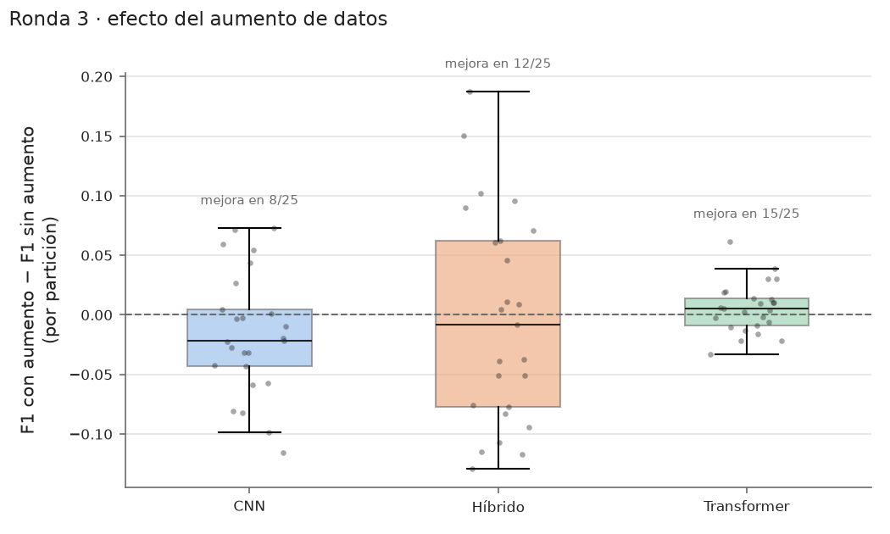

**Cómo se lee.** Para cada arquitectura y cada partición, el F1 con aumento menos el F1 sin
aumento. Por encima de la línea del 0, el aumento ayudó en esa partición; encima de cada caja, en
cuántas de las 25.

**Qué se ve.** El aumento **no ayuda de forma consistente** en ninguna arquitectura: mejora la CNN
en 8 de 25 particiones, el híbrido en 9 y el transformer en 16, con diferencias medias de −0,017,
−0,032 y +0,010. En el híbrido el efecto es muy variable (de −0,33 a +0,19 según la partición).

### 4. Precisión frente a coste


**Cómo se lee.** El F1 medio (± desviación) de cada modelo frente a su coste: operaciones por
segmento, número de parámetros y segundos de entrenamiento, en escala logarítmica. Un modelo
más caro solo compensa si sube.

**Qué se ve.** La línea base, con 5212 parámetros y unas 13 000 operaciones por segmento (5800
veces menos que la CNN), rinde igual que las redes y varía mucho menos. El transformer es la red
más barata (6,9 MFLOPs) y la peor.

### 5. Velocidad y memoria

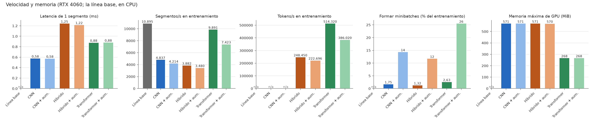

**Cómo se lee.** Medidas en la RTX 4060 (la línea base, en CPU): latencia de un segmento,
segmentos y tokens por segundo al entrenar (los tokens solo existen en el transformer y el
híbrido), qué parte del entrenamiento se va en formar los minibatches (casi toda es el aumento de
datos) y memoria máxima de GPU.

**Qué se ve.** Todo es muy pequeño para la GPU: como mucho 571 MiB de memoria y ~1,2 ms por
segmento. El transformer es la red más rápida (~9900 segmentos/s, ~514 000 tokens/s). El aumento
de datos cuesta: se lleva el 26 % del entrenamiento en el transformer con aumento y el 12-14 % en
la CNN y el híbrido con aumento, frente a menos del 3 % sin aumento.

### 6. Curvas de aprendizaje

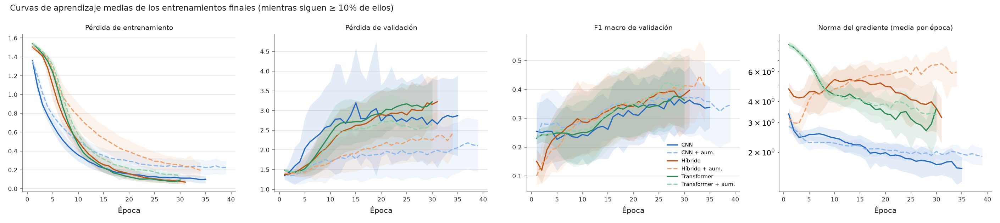

**Cómo se lee.** Media (y banda de ± 1 desviación) de los entrenamientos finales, época a época:
pérdida de entrenamiento, pérdida de validación, F1 de validación y norma del gradiente (en escala
logarítmica). Si la pérdida de entrenamiento baja mientras la de validación sube, el modelo está
memorizando: es el **sobreajuste**. Si la norma del gradiente crece, los pasos del entrenamiento
se hacen más grandes y menos estables.

**Qué se ve.** En todas las redes la pérdida de entrenamiento baja casi a 0 mientras la de
validación **sube desde las primeras épocas**: memorizan los buques de entrenamiento. Aun así, el
F1 de validación sigue subiendo despacio, porque la red acierta más clases aunque esté más
confiada en sus errores. La parada temprana elige de media la época 9-14. La norma del gradiente
baja en la CNN y el transformer, pero **crece en el híbrido con aumento** (de ~3 a ~6,5): su
entrenamiento es el menos estable.

### 7. Brecha de generalización

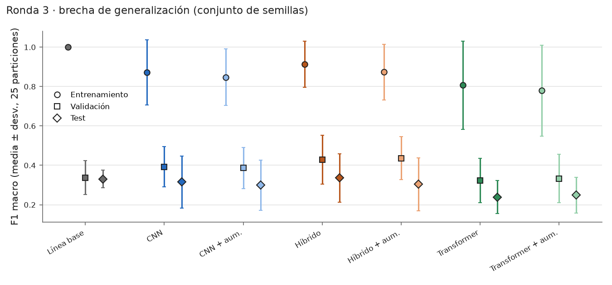

**Cómo se lee.** F1 del modelo final (media de sus semillas) en entrenamiento, validación y test,
con media y desviación de las 25 particiones. La distancia entre el círculo (entrenamiento) y el
rombo (test) es lo que el modelo memoriza y no generaliza.

**Qué se ve.** Todos memorizan mucho: en entrenamiento aciertan de 0,78 a 1,0 (la línea base, el
100 %) y en test, de 0,24 a 0,34. Validación queda algo por encima de test (de 0,32 a 0,44)
porque se usa para elegir la configuración y la época: es el optimismo que describen Varma y
Simon, y por eso la cifra que se da es la de test.

### 8. De dónde viene la variación

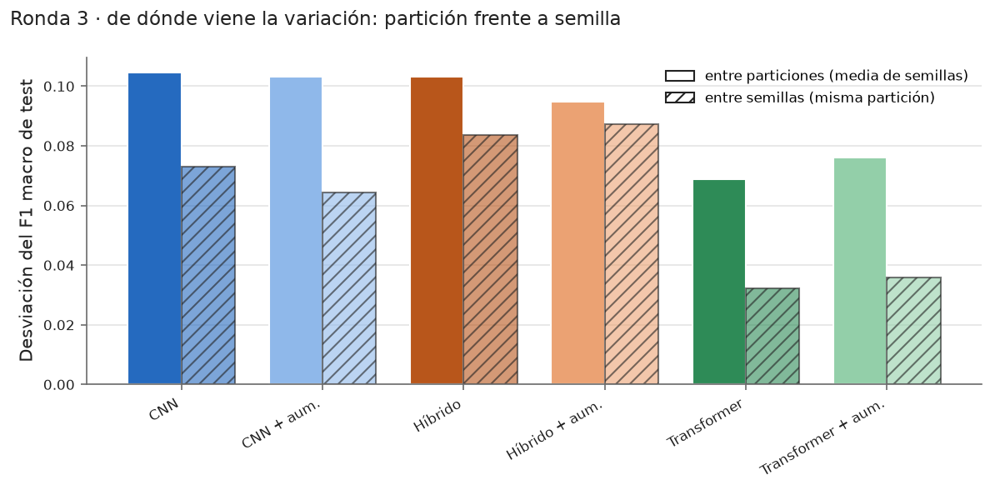

**Cómo se lee.** Separa de dónde viene la variación del F1 de test de cada red:

- **Variación por partición:** la desviación entre las 25 particiones del F1 medio de las 3
  semillas de cada partición, cada una puntuada por separado.
- **Variación por semilla:** la desviación entre las 3 semillas dentro de una misma partición.

No es la misma cifra que la **dispersión del modelo final entre particiones** de la tabla de
resultados (0,09-0,14): allí se puntúa el modelo final, que promedia las probabilidades de las 3
semillas antes de decidir. Promediar los F1 de 3 semillas suaviza los fallos propios de cada una;
el modelo combinado, en cambio, decide una sola vez por segmento y refuerza lo que las 3 semillas
tienen en común en esa partición (por ejemplo, predecir mucho Tanker), así que su resultado cambia
más de una partición a otra.

**Qué se ve.** La variación por partición pesa más que la variación por semilla en todas las redes
(0,07-0,10 frente a 0,03-0,09), como dicen Bouthillier et al. (2021): por eso se usan 25
particiones y no más semillas. Pero en las CNN y el híbrido la semilla también pesa mucho (0,06-0,09): con estos datos,
entrenar dos veces la misma red puede dar cifras bastante distintas.

### 9. Elección de configuración

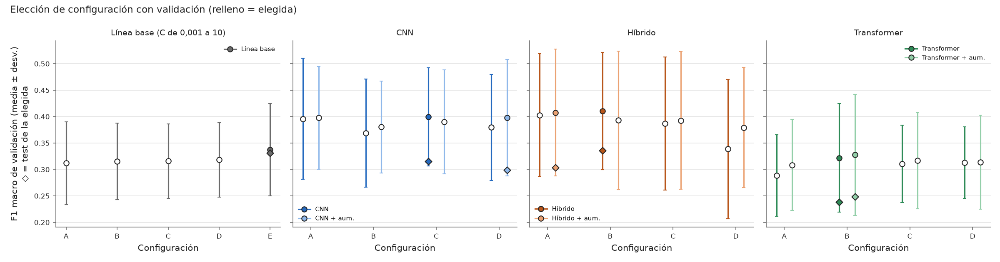

**Cómo se lee.** F1 de validación (media ± desviación de las 25 particiones) de cada
configuración; la rellena es la elegida y el rombo su F1 de test. Si las barras se solapan mucho,
la elección es casi un empate. Las configuraciones se explican en
[Por qué cada configuración](#por-qué-cada-configuración).

**Qué se ve.** En todas las redes las barras se solapan casi por completo: la elección es
prácticamente un empate, y la configuración importa mucho menos que la partición. En las redes,
el test de la elegida queda entre 0,07 y 0,10 por debajo de su validación: es el optimismo de
elegir con validación. En la línea base casi coinciden (0,337 frente a 0,331).

### 10. Matrices de confusión


**Cómo se leen.** Juntan todas las predicciones de test de las 25 particiones; cada segmento
cuenta 5 veces, una por repetición. Las filas son la clase real y las columnas la predicha; la
diagonal son los aciertos.

**Qué se ve.** Todas las redes predicen mucho **Tanker** (de 0,40 a 0,48 de los Cargo acaban ahí)
y confunden Passengership con Cargo y Tanker. El híbrido es el que más acierta Tug (0,45). La
línea base acierta sobre todo Cargo y Tanker, pero manda casi la mitad de los Tug a Cargo, la
otra clase de 2017: encaja con aprender la época más que el buque.

### 11. Acierto por buque

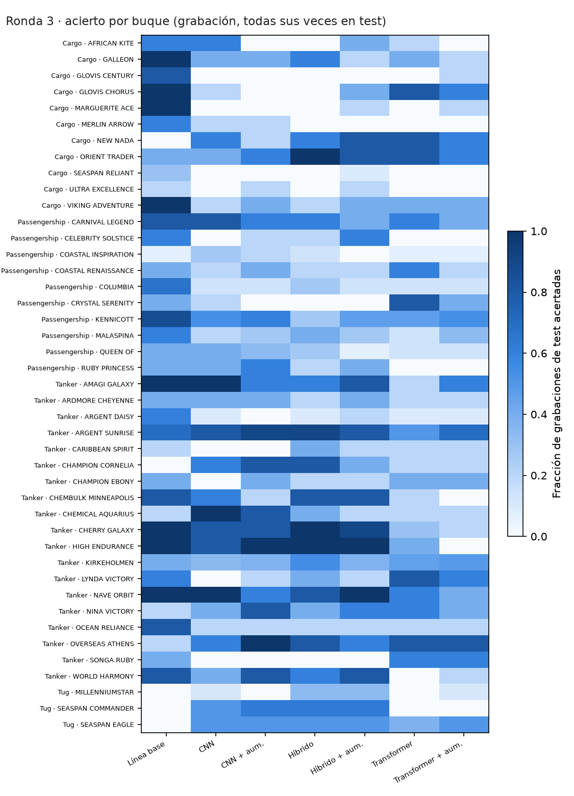

**Cómo se lee.** Una fila por buque y una columna por modelo: fracción de las veces que ese buque
estuvo en test en que sus grabaciones se clasificaron bien (de blanco, 0, a azul oscuro, 1).

**Qué se ve.** Hay buques que **casi ningún modelo acierta**: Cargo ULTRA EXCELLENCE y Tanker
CARIBBEAN SPIRIT, como mucho 1 de cada 5 veces con cualquier modelo. Otros se aciertan de media
el 70-80 % de las veces (Tanker ARGENT SUNRISE, NAVE ORBIT, HIGH ENDURANCE). El
resultado depende mucho de qué buques concretos caen en test, que es lo que se ve en la gráfica 1.

### 12. Acuerdo entre modelos

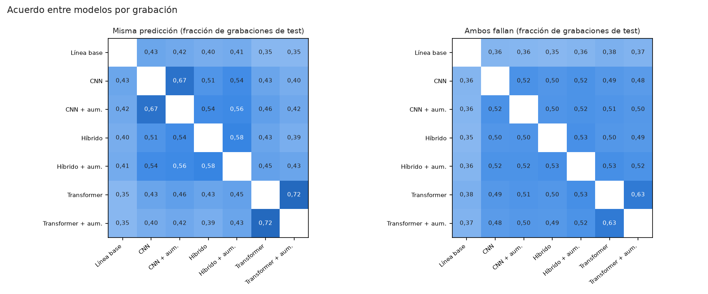

**Cómo se lee.** Para cada pareja de modelos, en qué fracción de las grabaciones de test predicen
lo mismo (izquierda) y en qué fracción fallan los dos (derecha). Si dos modelos fallan en sitios
distintos, combinarlos podría ayudar.

**Qué se ve.** Las versiones sin y con aumento de cada red se parecen mucho (predicen lo mismo en
el 58-72 % de las grabaciones). La línea base es la que más difiere de las redes (lo mismo en solo
el 35-43 %), y con ella al menos uno de los dos acierta en el 62-65 % de las grabaciones: son
las parejas que más podrían ganar combinándose, aunque no se ha probado.

### 13. Calibración

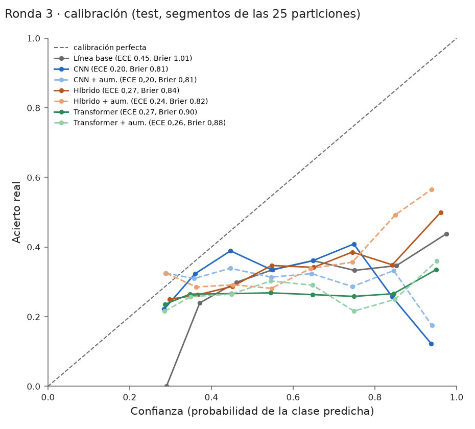

**Cómo se lee.** Si un modelo dice "80 % seguro", ¿acierta el 80 % de las veces? La diagonal es la
calibración perfecta; por debajo, el modelo está demasiado seguro. **ECE** (*expected calibration
error*: cuánto se aleja la confianza del acierto real) y **Brier** (error de las probabilidades):
cuanto más bajos, mejor.

**Qué se ve.** Todos están **demasiado seguros**: sus curvas quedan por debajo de la diagonal. La
línea base es la peor calibrada (ECE 0,45; dice estar muy segura y acierta poco); las redes
quedan entre 0,20 y 0,27. Ninguna probabilidad de estos modelos debería leerse como una
confianza real.

### 14. Qué frecuencias usa cada modelo


**Cómo se lee.** Arriba, una fila por modelo: cuánto depende de cada banda de 40 Hz, normalizado
al máximo de la fila. En la línea base es la caída de F1 al desordenar la banda; en las redes, la
caída de la probabilidad de acierto al taparla. La última fila es cuánto difiere esa banda entre
las grabaciones de 2016 y las de 2017. Abajo, a qué bandas mira el token de clase del
transformer y del híbrido. Todo sobre validación.

**Qué se ve.**

- **Todas las redes dependen sobre todo de 0-40 Hz**, y el híbrido y el transformer también de
  40-80 Hz. Son frecuencias muy bajas, donde dominan el ruido del mar y de la plataforma de
  grabación más que la firma del buque. La atención del híbrido apunta a esas mismas bandas.
- **La línea base usa sobre todo 1240-1320 Hz**, y **3 de sus 5 bandas principales están entre
  las 5 que más difieren entre épocas**. Puede que parte de su resultado venga de las
  condiciones de grabación y no del buque.
- No hay líneas tonales fijas de una época, y las relaciones con la diferencia entre épocas son
  débiles y poco fiables (bandas vecinas correlacionadas).

### 15. ROC de clasificación

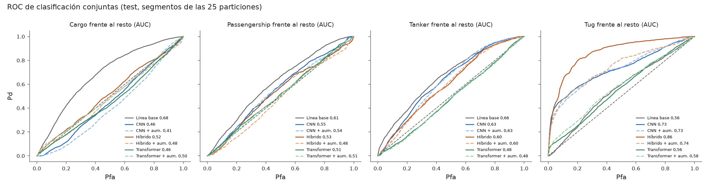

**Cómo se lee.** Para cada clase frente al resto: probabilidad de acertarla (Pd) frente a la de
confundir otra clase con ella (Pfa), con los segmentos de test de las 25 particiones juntos. El
número de la leyenda es el área bajo la curva (AUC): 0,5 es el azar y 1 la perfección. Es una
ROC de clasificación, no de detección (DeepShip no tiene grabaciones sin buque), y al juntar
particiones se mezclan 25 modelos distintos, así que el AUC es orientativo.

**Qué se ve.** **Tug es la clase que mejor separan la CNN y el híbrido** (AUC 0,73-0,86, el
híbrido el mejor), aunque solo hay 3 Tug; el transformer apenas (0,56-0,58). **Cargo, la peor**: las redes quedan en el azar o por debajo
(0,41-0,52), y solo la línea base la separa algo (0,68). Passengership y Tanker quedan entre 0,48
y 0,66.

## Conclusiones

1. **El modelo más simple es tan bueno como el más complejo:** la regresión logística rinde igual
   que las redes, es unas 5800 veces más barata y varía mucho menos entre particiones.
2. **Qué buques caen en test pesa más que el modelo elegido:** el F1 de una misma red va de ~0,1
   a ~0,57 según la partición. Una sola partición fija puede dar casi cualquier cifra.
3. **El transformer no funciona con tan pocos datos:** queda en el azar. El híbrido tiene la
   mejor media, pero sin diferencia significativa.
4. **El aumento de datos no ayuda** en ninguna arquitectura, y cuesta hasta un 26 % del tiempo de
   entrenamiento.
5. **Los modelos no demuestran escuchar al buque:** las redes dependen sobre todo de 0-80 Hz, donde
   dominan el mar y la plataforma, y la línea base usa bandas que delatan la época de grabación.
   Además, todos están demasiado seguros de sus predicciones.
6. **Siguiente paso:** más buques y clases grabadas en las mismas condiciones (por ejemplo
   ShipsEar, o el benchmark UniqueShip), no modelos más complejos.

## Puesta en marcha

Todo lo necesario para instalarlo, comprobarlo y, si quieres, reproducirlo. Solo hacen falta
git y Docker.

### Requisitos

- git
- Docker con Docker Compose v2 (en Windows y macOS, Docker Desktop)

No hace falta instalar Python ni ninguna librería: todo se ejecuta dentro del contenedor, con
Python 3.11.17 y versiones fijadas de cada librería. Lo que tengas instalado en tu ordenador no
se usa, así que no necesitas un entorno virtual ni preocuparte por las versiones.

### Instalación

1. Clona el repositorio:

   ```bash
   git clone https://github.com/davidmorgadocarames/sonar_investigacion.git
   cd sonar_investigacion
   ```

2. Elige una opción **una sola vez**:

   - **Opción A · CPU (por defecto).** No hagas nada: funciona en cualquier ordenador. Es todo lo
     que necesitas para la comprobación rápida y para regenerar el informe.
   - **Opción B · GPU NVIDIA (solo para reproducir los entrenamientos).** Necesitas una GPU NVIDIA de la
     serie RTX 20 / GTX 16 o posterior, con el driver 580 o más nuevo, y Docker Desktop con WSL2
     en Windows (o el NVIDIA Container Toolkit en Linux). Crea en la carpeta
     `sonar_investigacion` un fichero llamado `.env` con estas dos líneas:

     ```
     COMPOSE_PATH_SEPARATOR=:
     COMPOSE_FILE=compose.yaml:compose.gpu.yaml
     ```

     A partir de ahí, todos los comandos de este README son los mismos y usan tu GPU. La imagen
     de la opción B ocupa unos 9,4 GB. Si tu driver es demasiado antiguo, el contenedor fallará al
     arrancar: actualiza el driver o borra `.env` para volver a la opción A.

3. **Solo en Linux:** para que los ficheros que escribe el contenedor sean tuyos, añade tu
   usuario al fichero `.env` (se crea si no existe). En Windows y macOS no hace falta.

   ```bash
   printf '\nHOST_UID=%s\nHOST_GID=%s\n' "$(id -u)" "$(id -g)" >> .env
   ```

   El salto de línea inicial evita pegarse a la última línea del `.env` de la opción B.

   **Con Docker sin root (*rootless*) o con Podman** el usuario `root` del contenedor ya
   corresponde a tu usuario del host: en ese caso pon en `.env` `HOST_UID=0` y `HOST_GID=0`
   (comprobado que la imagen funciona con el UID 0; sin probar en un Docker *rootless* real).

4. Construye la imagen. La primera vez tarda unos minutos; la imagen de la opción A ocupa unos
   1,9 GB:

   ```bash
   docker compose build
   ```

5. Comprueba que funciona:

   ```bash
   docker compose run --rm pipeline --help
   ```

   Debe mostrar los comandos `qc`, `features`, `train`, `evaluate` y `report`.

### Comprobar la instalación

```bash
docker compose run --rm --entrypoint python pipeline -m pytest -rs
```

Tarda entre uno y dos minutos (~1 min 40 s con los datos descargados). Debe terminar con todos los tests en verde (`passed`). La opción `-rs`
lista los tests saltados y por qué: sin los datos descargados se saltan los que los necesitan
(dicen `not found` o `without WAVs`, y los que necesitan los rasgos dicen `has no features: run
features first`). En la opción A se saltan los de determinismo en CUDA (dicen `no CUDA here`) y
en la opción B el que comprueba el error sin GPU (dice `this machine has CUDA`). Saltarse no es
un error. Cuando hayas descargado los datos y calculado los rasgos (`features`, más abajo),
vuelve a lanzarlo: solo deben saltarse los de CUDA (4 en la opción A, 1 en la B).

| Cuándo lo lanzas | Opción A (CPU) | Opción B (GPU) |
|---|---|---|
| Recién instalado, sin datos | Se saltan 11: 7 necesitan los audios o los rasgos, y 4 son de determinismo en CUDA | Se saltan 8: los 7 de los datos y el que comprueba el error sin GPU |
| Con los datos y los rasgos | Se saltan 4 (CUDA) | Se salta 1 (error sin GPU) |

Los tests cubren todas las partes: control de calidad, LOFAR y DEMON con señales sintéticas,
particiones y fugas, los modelos (línea base, CNN, transformer e
híbrido), el motor de la validación cruzada (elección sin test, comparaciones), la interpretabilidad, las figuras y el informe.
Todos usan datos sintéticos pequeños salvo los que comprueban los datos reales.

### Descargar los datos

Los audios **no están en este repositorio**. Se descargan del repositorio público de los
autores de DeepShip, fijado en una versión concreta para que todos usemos exactamente los mismos
ficheros. Licencia, contenido y detalles: [datasets/README.md](datasets/README.md).

Los datos sirven para todos los modelos. **No hacen falta para leer los resultados ni para
regenerar el informe**: solo para la comprobación rápida y para reproducir los resultados.

Necesitas unos **1,2 GB** libres: unos 700 MB de audio y unos 500 MB del historial de git de
DeepShip (la carpeta `.git`), que es lo que permite comprobar que los ficheros están íntegros.
Desde la carpeta `sonar_investigacion`, ejecuta estos dos
comandos (el primero tarda alrededor de un minuto, según tu conexión):

```bash
git clone -c core.autocrlf=false https://github.com/irfankamboh/DeepShip.git datasets/raw/DeepShip
git -C datasets/raw/DeepShip checkout 77725726a33d6aef4ce1d0fe70f67c0bbee4b5b6
```

**En Windows**, si el repositorio está en una carpeta con una ruta muy larga, el primer comando
puede fallar con `Filename too long`. Clónalo en una ruta corta (por ejemplo `C:\proyectos`) o
activa las rutas largas una vez con `git config --global core.longpaths true`.

El segundo comando muestra un aviso de *detached HEAD*. Es normal: significa que estás en esa
versión fija.

Para comprobar que la descarga es correcta:

```bash
git -C datasets/raw/DeepShip status
```

Debe decir `HEAD detached at 7772572` y `nothing to commit, working tree clean`. Eso garantiza
que los ficheros son idénticos a los de la versión fijada. Deben quedar 63 ficheros `.wav`
repartidos en `Cargo/` (12), `Passengership/` (20), `Tanker/` (28) y `Tug/` (3).

Si ya lo habías descargado, no hace falta repetirlo.

### Control de calidad y rasgos

Con los datos descargados, desde la carpeta `sonar_investigacion`:

```bash
docker compose run --rm pipeline qc
docker compose run --rm pipeline features
```

- `qc` revisa los 63 WAV (formato, duración, offset DC, saturación...) en unos segundos y escribe
  `outputs/qc/qc.csv`. No modifica ni excluye ningún fichero. El **offset DC** es que la señal no
  está centrada en 0, sino desplazada un valor constante por la cadena de grabación; `qc` marca
  `flag_dc` cuando ese desplazamiento supera el 10 % de la amplitud típica de la señal (su
  desviación típica). Lo marca en **las 63 grabaciones**, y es normal: `features` lo corrige
  restando a cada grabación su media.
- `features` tarda menos de un minuto. Comprueba que cada WAV es idéntico al de la versión
  fijada (SHA-256 de `datasets/manifests/vessels.csv`), quita el offset DC de cada grabación, la
  corta en segmentos de 3 s y calcula el LOFAR (líneas tonales, 0 a 2 kHz) y el DEMON (modulación
  de la cavitación, 0 a 100 Hz) de cada segmento. Debe decir `63 recordings, 1889 segments` y
  mostrar cuántos segmentos tiene cada clase. Escribe en `datasets/processed/` unos 82 MB: los
  segmentos, `index.csv` (una fila por segmento) y `features_meta.json` (parámetros usados). Esa
  carpeta no se sube a git.
- Los segmentos se guardan en **tres ficheros** (`features_train.npz`, `features_val.npz` y
  `features_test.npz`) **solo por cómo se almacenan**: no son una partición de la evaluación. La
  evaluación los junta y usa las **25 particiones** de `datasets/manifests/cv_splits.csv` (5
  repeticiones × 5 vueltas), explicadas en
  [Protocolo de evaluación](#protocolo-de-evaluación-validación-cruzada-5--5).

Figuras de ejemplo (en `outputs/figures/`, que no se sube a git):

```bash
docker compose run --rm pipeline features --figures
docker compose run --rm --entrypoint python pipeline -m pytest tests/test_figures.py --figures-dir outputs/figures
```

- El primero calcula los rasgos y dibuja, para una grabación larga de cada clase, su LOFARgram y
  su DEMON medio: `example_<clase>.png`.
- El segundo dibuja la validación con señales sintéticas: un tono de 440 Hz debe salir en
  440 Hz en el LOFAR (`validation_lofar.png`), y un ruido modulado a 12 Hz debe dar un pico en
  12 Hz en el DEMON (`validation_demon.png`).

### Comprobación rápida de los resultados

Con los rasgos calculados, comprueba en CPU que tu instalación da las mismas cifras que las
publicadas:

```bash
docker compose run --rm pipeline evaluate --round 3 --check
```

`--round 3` es el nombre que tiene en el código esta evaluación (la validación cruzada de los 7
modelos); también aparece en los nombres de algunas carpetas y ficheros (`round3`). Tarda unos
segundos. Usa los 7 modelos representativos versionados (uno por modelo, de la
primera partición y la semilla 0), puntúa el test de esa partición y lo compara con lo guardado
en `docs/results/round3.json`. No entrena ni elige nada. Debe decir `Reproduces the round 3
results`. Los modelos se entrenaron en GPU, así que en CPU algún segmento puede cambiar de clase:
se admiten diferencias de hasta ±0,01 de F1 (2 o 3 segmentos). En el equipo de referencia sale
idéntico en 6 modelos y +0,0045 en el híbrido con aumento.

### Regenerar el informe

El informe completo (`docs/report.md`) y todas sus gráficas se regeneran desde los resúmenes
versionados, sin datos ni entrenamiento:

```bash
docker compose run --rm pipeline report
```

Tarda menos de un minuto. Con `git status` puedes comprobar que no cambia ningún fichero.

### Reproducir los resultados (opcional, solo GPU)

> ⏱️ **Tiempo: ~1 h 40 min con GPU (RTX 4060); del orden de 10 a 30 h solo con CPU.**

**Modelos que se entrenan (7, en este orden):** línea base, CNN, CNN con aumento, híbrido,
híbrido con aumento, transformer y transformer con aumento. Cada red prueba 4
configuraciones (la línea base, 5 valores de C) en las 25 particiones, y la elegida se entrena
con 3 semillas.

No hace falta para leer los resultados. Reproducirlos entrena
**900 redes y 125 líneas base**, así que solo tiene sentido con la opción B (GPU): en CPU, el paso
1 tarda ~1 min 20 s y mide unos 2-2,6 s por época en la CNN y el híbrido, lo que da del orden de
10 a 30 horas para todo. Necesitas los
rasgos (`features`) y unos 400 MB libres para los pesos.

| Paso | Comando | Tiempo (RTX 4060) |
|---|---|---|
| 1. Medir antes (opcional) | `docker compose run --rm pipeline train --round 3 --measure` | ~1 min |
| 2. Entrenar los 7 modelos | `docker compose run --rm pipeline train --round 3` | ~1 h 40 min |
| 3. Interpretabilidad | `docker compose run --rm pipeline evaluate --round 3 --interpretability --device cuda` | ~10 min |
| 4. Datos de las gráficas | `docker compose run --rm pipeline evaluate --round 3 --details --device cuda` | ~1 min |
| 5. Informe y gráficas | `docker compose run --rm pipeline report` | ~1 min |

- **Paso 1:** entrena 2 épocas de cada configuración en la primera partición y muestra el tiempo
  por época y la memoria de GPU. Solo escribe `outputs/round3/measure.json` y añade líneas a
  `outputs/round3/run.log`.
- **Paso 2:** entrena los modelos uno detrás de otro: línea base, CNN, CNN con aumento, híbrido,
  híbrido con aumento, transformer y transformer con aumento. **Si se interrumpe, al relanzarlo
  continúa** donde lo dejó: no repite los entrenamientos terminados con el mismo código. Si un
  modelo falla, apunta el error en `outputs/round3/<modelo>/error.txt` y sigue con los demás.
  `--only cnn hybrid` entrena solo esos modelos. Escribe:
  - `models/round3/<modelo>/`: todos los pesos, cada entrenamiento en su fichero. No se suben a
    git.
  - `outputs/round3/<modelo>/`: un JSON por entrenamiento, con la configuración, el código y los
    datos usados, el coste (parámetros, MFLOPs), la velocidad (segmentos/s, tokens/s, latencia,
    memoria de GPU), la curva de aprendizaje, los resultados y las predicciones por grabación.
  - `docs/results/round3.json` y `models/round3/representative/`: **sobrescribe los versionados**.
    Compara con `git diff`, y vuelve a ellos con `git checkout -- docs/results models/round3`.
- **Paso 3:** mide los 7 modelos finales sobre validación (oclusión, saliencia o permutación
  por banda); la atención, solo en el transformer y el híbrido.
- **Paso 4:** resume los 7 modelos (velocidad, curvas, calibración, acierto por buque...).
- **Pasos 3 y 4:** no entrenan nada, y test solo se lee de lo que guardó el paso 2. Sin
  `--device cuda` corren en CPU (más despacio, y las cifras pueden variar en la última
  cifra); el dispositivo queda registrado en cada JSON.
- Las redes son deterministas en el mismo tipo de GPU. En otra GPU, o en CPU, las cifras
  cambian algo.

`models/round3/representative/` guarda, versionado, un modelo de cada red (repetición 0, vuelta 0,
semilla 0, con la configuración elegida), con un `.json` que dice su configuración: sirve para
inspeccionar la arquitectura sin entrenar.

## Limitaciones

Explicadas en el [informe](docs/report.md). En resumen:

- **Clase y época coinciden** (limitación conocida de estos datos): Cargo y Tug se grabaron en
  2017, y Passengership y
  Tanker en 2016. El resultado de 4 clases no distingue el tipo de buque de las condiciones de
  grabación; solo las comparaciones dentro de una época están libres de ese efecto.
- **Pocos buques:** 43 en total, y Tug solo 3. Cada Tug cae en test 8 o 9 veces, y el
  solapamiento entre particiones en esa clase es mayor del que corrige la prueba de Nadeau y
  Bengio.
- **El resultado depende mucho de la partición:** la dispersión del modelo final entre
  particiones es de 0,09-0,14 de F1 en las redes, y la variación por semilla dentro de una
  partición, de 0,03-0,09 (gráfica 8).
- **La ROC es de clasificación**, no de detección: DeepShip no tiene grabaciones sin buque, así
  que no se pueden medir falsas alarmas ante mar vacío (ver [Los datos](#los-datos)).
- **Las figuras conjuntas** (matrices, ROC, calibración) juntan predicciones de 25 modelos
  distintos: las cifras por partición son las de referencia.

## Procedencia

Antes de estos resultados hubo evaluaciones exploratorias y un reentrenamiento tras corregir un
fallo de implementación; su detalle está en el [informe completo](docs/report.md) y en
[docs/results/README.md](docs/results/README.md), con qué código produjo cada cifra. Los
resultados de este README salen del código del commit `7df7a96`.

## Equipo de referencia

Todos los tiempos y resultados de este README se midieron en:

| Componente | Detalle |
|---|---|
| CPU | Intel Core i7-14700KF (28 hilos), x86-64 |
| GPU | NVIDIA GeForce RTX 4060, 8 GB (driver 610.62; PyTorch 2.14.1 con CUDA 13.0) |
| Sistema | Windows 10 Pro con Docker Desktop (WSL2) |
| Imágenes | `sonar-pipeline:latest` (CPU, 1,9 GB) y `sonar-pipeline:gpu` (9,4 GB) |

## Carpetas

| Carpeta | Qué contiene |
|---|---|
| `datasets/` | Manifiestos versionados (`manifests/`); audios y rasgos, no (`raw/`, `processed/`). |
| `models/` | En `models/round3/representative/`, los 7 modelos representativos, versionados; el resto de pesos de la validación cruzada se guarda en `models/round3/` sin versionar. Los ficheros de la raíz de `models/` son de las evaluaciones exploratorias anteriores ([docs/results/README.md](docs/results/README.md)). |
| `docs/` | Informe, resúmenes de resultados y figuras, versionados (montada en el contenedor para `report`). |
| `outputs/` | Resultados de cada ejecución (en `round3/`, un JSON por entrenamiento). No se suben a git. |
| `src/sonar_pipeline/` | Código de la pipeline. |
| `tests/`, `tools/` | Tests y scripts de apoyo. |

## Licencia

El código y la documentación están bajo la licencia MIT ([LICENSE](LICENSE)), © 2026 David
Morgado Carames. No cubre los datos de DeepShip (no se distribuyen aquí) ni los pesos de
`models/`, que derivan de DeepShip y siguen su mismo supuesto de uso académico.

## Cita

Datos: Irfan, M. et al. (2021). *DeepShip: An underwater acoustic benchmark dataset and a
separability based deep learning framework for ship classification.* Expert Systems with
Applications, 183, 115270.

DeepShip no tiene licencia explícita: se asume que puede usarse con fines académicos citando a
los autores (supuesto no confirmado por ellos), y ningún audio se redistribuye. Detalles en
[datasets/README.md](datasets/README.md).
