# sonar_investigacion

Pipeline de procesado de señal sonar pasivo sobre el dataset DeepShip (4 clases: Cargo,
Passengership, Tanker, Tug):

```
WAV → control de calidad → preprocesado → LOFAR y DEMON → clasificador → evaluación → informe
```

**Resultado principal (ronda 3, validación cruzada 5 × 5 por buque):** se compararon 7 modelos
entrenados desde cero, de una regresión logística a un transformer. El mejor F1 macro de test es
el del híbrido CNN + transformer (0,343 ± 0,126), y la línea base sacó 0,331 ± 0,046, frente a un
azar de 0,242. **Ninguna diferencia entre modelos es significativa** (prueba de Nadeau y Bengio
con corrección de Holm). Además, la clase coincide con la época de grabación, así que con estos
datos no se puede afirmar que algún modelo reconozca la firma del buque. Informe completo:
[docs/report.md](docs/report.md).

> ⚠️ **Resultados provisionales.** En esta versión, el transformer y el híbrido (sin y con
> aumento) entrenaron con un *learning rate* máximo de 4,1e-4 en lugar de los 5e-4 declarados,
> por un fallo del calentamiento que encontró la revisión del código: el lr subía bien durante
> las 5 épocas de calentamiento, pero al terminarlas se quedaba en el 82 % en vez de pasar al
> 100 %. La CNN y la línea base no tienen calentamiento y no se ven afectadas. No es una fuga:
> test no intervino en nada. La ronda se reentrenará con el fallo corregido (F5-T10), y esos
> resultados sustituirán a estos, que se conservarán como histórico. Como el reentrenamiento se
> hace **después de haber visto test**, se declara igual que la ronda 2: es un arreglo de
> implementación decidido por la revisión del código, no por las cifras
> ([ajuste 3 de D-024](DECISIONS.md)).

## Cronología

El proyecto se hizo por etapas. Cada ronda de resultados se mide de una forma distinta, así que
**sus cifras no son directamente comparables**: la de referencia es la ronda 3.

| Etapa | Fase | Qué se hizo | Evaluación | Versión |
|---|---|---|---|---|
| Datos y señal | F1-F2 | DeepShip, partición por buque, LOFAR y DEMON | Tests con señales sintéticas | — |
| Ronda 1 | F3 | Línea base, CNN sin aumento y CNN con aumento | Una partición fija (12 buques en test) | — |
| Ronda 2 | F3 | Los mismos modelos, tras arreglar los fallos de la revisión | La misma partición, segunda y última vez | `v0.1` |
| Entrega | F4 | README, informe y reproducción comprobada por un tercero | — | `v0.1.1` |
| **Ronda 3** | F5 | **7 modelos**: se añaden un transformer y un híbrido, y cada red se prueba sin y con aumento | **Validación cruzada 5 × 5 por buque (25 particiones)** | `v0.2` |

## Contenido

- **Cómo usarlo** (común a todas las rondas): [Requisitos](#requisitos) ·
  [Puesta en marcha](#puesta-en-marcha) · [Comprobar la instalación](#comprobar-la-instalación) ·
  [Datos](#datos) · [Control de calidad y rasgos](#control-de-calidad-y-rasgos) ·
  [Evaluar con los pesos entrenados](#evaluar-con-los-pesos-entrenados-rondas-1-y-2) ·
  [Reproducir la ronda 3](#reproducir-la-ronda-3-opcional-solo-gpu) ·
  [Reentrenar los modelos de F3](#reentrenar-los-modelos-de-f3-opcional)
- **Datos y señal en gráficas** (común): [Datos](#1-datos) · [LOFAR y DEMON](#2-señal-qué-son-lofar-y-demon) ·
  [Un buque real](#3-un-buque-real)
- **Ronda 3 (F5), la evaluación principal:** [Protocolo](#protocolo-validación-cruzada-5--5) ·
  [Los modelos por dentro](#los-modelos-por-dentro) ·
  [Por qué cada configuración](#por-qué-cada-configuración) ·
  [Resultados en gráficas](#resultados-de-la-ronda-3-en-gráficas)
- **Rondas 1 y 2 (F3), histórico:** [Resultados](#rondas-1-y-2-f3-partición-fija--histórico)
- [Limitaciones](#limitaciones) · [Procedencia](#procedencia) ·
  [Equipo de referencia](#equipo-de-referencia) · [Carpetas](#carpetas) · [Licencia](#licencia) ·
  [Cita](#cita)

## Requisitos

- git
- Docker con Docker Compose v2 (en Windows y macOS, Docker Desktop)

No hace falta instalar Python ni ninguna librería: todo se ejecuta dentro del contenedor, con
Python 3.11.17 y versiones fijadas de cada librería. Lo que tengas instalado en tu ordenador no
se usa, así que no necesitas un entorno virtual ni preocuparte por las versiones (D-021).

## Puesta en marcha

1. Clona el repositorio (es privado; necesitas que David te dé acceso):

   ```bash
   git clone https://github.com/davidmorgadocarames/sonar_investigacion.git
   cd sonar_investigacion
   ```

2. Elige una opción **una sola vez**:

   - **Opción A · CPU (por defecto).** No hagas nada: funciona en cualquier ordenador. Es todo lo
     que necesitas para evaluar con los pesos entrenados.
   - **Opción B · GPU NVIDIA (solo para reentrenar más rápido).** Necesitas una GPU NVIDIA de la
     serie RTX 20 / GTX 16 o posterior, con el driver 580 o más nuevo, y Docker Desktop con WSL2
     en Windows (o el NVIDIA Container Toolkit en Linux). Crea en la carpeta
     `sonar_investigacion` un fichero llamado `.env` con estas dos líneas:

     ```
     COMPOSE_PATH_SEPARATOR=:
     COMPOSE_FILE=compose.yaml:compose.gpu.yaml
     ```

     A partir de ahí, todos los comandos de este README son los mismos y usan tu GPU. La imagen
     de la opción B ocupa unos 9,4 GB. Si tu driver es demasiado antiguo, el contenedor fallará al
     arrancar: actualiza el driver o borra `.env` para volver a la opción A.

3. **Solo en Linux:** para que los ficheros que escribe el contenedor sean tuyos, añade tu
   usuario al fichero `.env` (se crea si no existe). En Windows y macOS no hace falta.

   ```bash
   printf '\nHOST_UID=%s\nHOST_GID=%s\n' "$(id -u)" "$(id -g)" >> .env
   ```

   El salto de línea inicial evita pegarse a la última línea del `.env` de la opción B.

   **Con Docker sin root (*rootless*) o con Podman** el usuario `root` del contenedor ya
   corresponde a tu usuario del host: en ese caso pon en `.env` `HOST_UID=0` y `HOST_GID=0`
   (comprobado que la imagen funciona con el UID 0; sin probar en un Docker *rootless* real).

4. Construye la imagen. La primera vez tarda unos minutos; la imagen de la opción A ocupa unos
   1,9 GB:

   ```bash
   docker compose build
   ```

5. Comprueba que funciona:

   ```bash
   docker compose run --rm pipeline --help
   ```

   Debe mostrar los comandos `qc`, `features`, `train`, `evaluate` y `report`.

## Comprobar la instalación

```bash
docker compose run --rm --entrypoint python pipeline -m pytest -rs
```

Tarda alrededor de un minuto. Debe terminar con todos los tests en verde (`passed`). La opción `-rs`
lista los tests saltados y por qué: sin los datos descargados se saltan los que los necesitan
(dicen `not found` o `without WAVs`, y los que necesitan los rasgos dicen `has no features: run
features first`). En la opción A se saltan los de determinismo en CUDA (dicen `no CUDA here`) y
en la opción B el que comprueba el error sin GPU (dice `this machine has CUDA`). Saltarse no es
un error. Cuando hayas descargado los datos y calculado los rasgos (`features`, más abajo),
vuelve a lanzarlo: solo deben saltarse los de CUDA (4 en la opción A, 1 en la B).

| Cuándo lo lanzas | Opción A (CPU) | Opción B (GPU) |
|---|---|---|
| Recién instalado, sin datos | Se saltan 11: 7 necesitan los audios o los rasgos, y 4 son de determinismo en CUDA | Se saltan 8: los 7 de los datos y el que comprueba el error sin GPU |
| Con los datos y los rasgos | Se saltan 4 (CUDA) | Se salta 1 (error sin GPU) |

Los tests cubren todas las partes: control de calidad, LOFAR y DEMON con señales sintéticas,
particiones y fugas, los modelos de las rondas 1 y 2, el motor de la ronda 3 (transformer,
híbrido, elección sin test, comparaciones), la interpretabilidad, las figuras y el informe.
Todos usan datos sintéticos pequeños salvo los que comprueban los datos reales.

## Datos

Los audios **no están en este repositorio**. Se descargan del repositorio público de los
autores de DeepShip, fijado en una versión concreta para que todos usemos exactamente los mismos
ficheros. Licencia, contenido y detalles: [datasets/README.md](datasets/README.md).

Los mismos datos sirven para todas las rondas y todos los modelos. **No hacen falta para leer
los resultados ni para regenerar el informe**: solo para evaluar (rondas 1 y 2), reentrenar o
reproducir la ronda 3.

Necesitas unos **1,2 GB** libres: unos 700 MB de audio y unos 500 MB del historial de git de
DeepShip (la carpeta `.git`), que es lo que permite comprobar que los ficheros están íntegros.
Desde la carpeta `sonar_investigacion`, ejecuta estos dos
comandos (el primero tarda alrededor de un minuto, según tu conexión):

```bash
git clone -c core.autocrlf=false https://github.com/irfankamboh/DeepShip.git datasets/raw/DeepShip
git -C datasets/raw/DeepShip checkout 77725726a33d6aef4ce1d0fe70f67c0bbee4b5b6
```

**En Windows**, si el repositorio está en una carpeta con una ruta muy larga, el primer comando
puede fallar con `Filename too long`. Clónalo en una ruta corta (por ejemplo `C:\proyectos`) o
activa las rutas largas una vez con `git config --global core.longpaths true`.

El segundo comando muestra un aviso de *detached HEAD*. Es normal: significa que estás en esa
versión fija.

Para comprobar que la descarga es correcta:

```bash
git -C datasets/raw/DeepShip status
```

Debe decir `HEAD detached at 7772572` y `nothing to commit, working tree clean`. Eso garantiza
que los ficheros son idénticos a los de la versión fijada. Deben quedar 63 ficheros `.wav`
repartidos en `Cargo/` (12), `Passengership/` (20), `Tanker/` (28) y `Tug/` (3).

Si ya lo habías descargado, no hace falta repetirlo.

## Control de calidad y rasgos

Con los datos descargados, desde la carpeta `sonar_investigacion`:

```bash
docker compose run --rm pipeline qc
docker compose run --rm pipeline features
```

- `qc` revisa los 63 WAV (formato, duración, offset DC, saturación...) en unos segundos y escribe
  `outputs/qc/qc.csv`. No modifica ni excluye ningún fichero. Es normal que marque `flag_dc` en
  casi todas las grabaciones: todas tienen un offset DC, y `features` lo corrige (D-009).
- `features` tarda menos de un minuto. Comprueba que cada WAV es idéntico al de la versión
  fijada (SHA-256 de `datasets/manifests/vessels.csv`), quita el offset DC de cada grabación, la
  corta en segmentos de 3 s y calcula el LOFAR (líneas tonales, 0 a 2 kHz) y el DEMON (modulación
  de la cavitación, 0 a 100 Hz) de cada segmento. Debe decir `63 recordings, 1889 segments` y
  escribir en `datasets/processed/` unos 82 MB: un `features_<partición>.npz` por partición
  (train, val y test), `index.csv` (una fila por segmento) y `features_meta.json` (parámetros
  usados). Esa carpeta no se sube a git.

Figuras de ejemplo (en `outputs/figures/`, que no se sube a git):

```bash
docker compose run --rm pipeline features --figures
docker compose run --rm --entrypoint python pipeline -m pytest tests/test_figures.py --figures-dir outputs/figures
```

- El primero calcula los rasgos y dibuja, para la grabación más larga de cada clase dentro de
  la partición de entrenamiento (para no mirar val ni test), su LOFARgram y su DEMON medio:
  `example_<clase>.png`.
- El segundo dibuja la validación con señales sintéticas: un tono de 440 Hz debe salir en
  440 Hz en el LOFAR (`validation_lofar.png`), y un ruido modulado a 12 Hz debe dar un pico en
  12 Hz en el DEMON (`validation_demon.png`).

## Evaluar con los pesos entrenados (rondas 1 y 2)

Evalúa **solo los 3 modelos de las rondas 1 y 2** (línea base, CNN y CNN con aumento), con sus
pesos ya versionados y sin entrenar nada. Puntúa la partición fija de esas rondas con los pesos
de `models/` (en total menos de 1 MB). Con los rasgos ya
calculados (`features`, sección anterior):

```bash
docker compose run --rm pipeline evaluate
```

Tarda unos 30 segundos en CPU. Puntúa la partición de test con los tres modelos y escribe
`outputs/results/metrics.json` y las figuras `outputs/figures/results_*.png`. Debe mostrar estas
cifras de F1 macro por segmento, idénticas a las del informe (`docs/results/eval2.json`). La
reproducción exacta está comprobada en x86-64 (ver "Equipo de referencia"); en otros
procesadores, sobre todo ARM (Apple Silicon), puede variar la última cifra:

| Modelo | Debe salir |
|---|---|
| `baseline` | `segment F1 0.374 (0.27-0.47)` |
| `cnn` | `segment F1 0.115 (0.07-0.16)` |
| `cnn_aug` | `segment F1 0.252 (0.17-0.34)` |

Para comprobarlo de una vez (mismos pesos y todas las cifras de test dentro de ±0,005, que
admite variaciones de la última cifra en otros procesadores):

```bash
docker compose run --rm --entrypoint python pipeline tools/check_reproduction.py
```

Debe decir `Reproduces the reference evaluation`.

Si comparas tu `metrics.json` con `docs/results/eval2.json`, el `code_sha256` será distinto: el
código cambió después de la evaluación 2 sin afectar a las cifras (detalle en
[docs/results/README.md](docs/results/README.md)). Las métricas y los `weights_sha256` deben
coincidir.

Otras opciones de `evaluate`:

- `--plot-only`: redibuja las figuras desde `metrics.json` sin volver a puntuar.
- `--interpretability`: qué bandas de frecuencia usa cada modelo (sobre val, unos 30 s).
- Para la ronda 3, ver la sección siguiente.

Para regenerar el informe (`docs/report.md`, que cubre todas las rondas), la figura de datos y
las 15 gráficas de la ronda 3 (`docs/figures/round3/`) desde los resultados versionados (no hace
falta haber descargado los datos ni entrenar; las figuras de las rondas 1 y 2 y las de señal son
fijas):

```bash
docker compose run --rm pipeline report
```

## Reproducir la ronda 3 (opcional, solo GPU)

> ⏱️ **Tiempo: ~1 h 40 min con GPU (RTX 4060); del orden de 10 a 30 h solo con CPU.**

**Modelos que se entrenan (7, en este orden):** línea base, CNN, CNN con aumento, híbrido,
híbrido con aumento, transformer y transformer con aumento. Cada red prueba 4
configuraciones (la línea base, 5 valores de C) en las 25 particiones, y la elegida se entrena
con 3 semillas.

No hace falta para leer los resultados: el informe y sus 15 gráficas se regeneran desde los
resúmenes versionados (`docker compose run --rm pipeline report`). Reproducir la ronda 3 entrena
**900 redes y 125 líneas base**, así que solo tiene sentido con la opción B (GPU): en CPU, el paso
1 tarda ~1 min 20 s y mide unos 2-2,6 s por época en la CNN y el híbrido, lo que da del orden de
10 a 30 horas para la ronda completa. Necesitas los
rasgos (`features`) y unos 400 MB libres para los pesos.

| Paso | Comando | Tiempo (RTX 4060) |
|---|---|---|
| 1. Medir antes (opcional) | `docker compose run --rm pipeline train --round 3 --measure` | ~1 min |
| 2. Entrenar los 7 modelos | `docker compose run --rm pipeline train --round 3` | ~1 h 40 min |
| 3. Interpretabilidad | `docker compose run --rm pipeline evaluate --round 3 --interpretability --results-dir docs/results --device cuda` | ~10 min |
| 4. Datos de las gráficas | `docker compose run --rm pipeline evaluate --round 3 --details --results-dir docs/results --device cuda` | ~1 min |
| 5. Informe y gráficas | `docker compose run --rm pipeline report` | ~1 min |

- **Paso 1:** entrena 2 épocas de cada configuración en la primera partición y muestra el tiempo
  por época y la memoria de GPU. Solo escribe `outputs/round3/measure.json` y añade líneas a
  `outputs/round3/run.log`.
- **Paso 2:** entrena los modelos uno detrás de otro: línea base, CNN, CNN con aumento, híbrido,
  híbrido con aumento, transformer y transformer con aumento. **Si se interrumpe, al relanzarlo
  continúa** donde lo dejó: no repite los entrenamientos terminados con el mismo código. Si un
  modelo falla, apunta el error en `outputs/round3/<modelo>/error.txt` y sigue con los demás.
  `--only cnn hybrid` entrena solo esos modelos. Escribe:
  - `models/round3/<modelo>/`: todos los pesos, cada entrenamiento en su fichero. No se suben a
    git.
  - `outputs/round3/<modelo>/`: un JSON por entrenamiento, con la configuración, el código y los
    datos usados, el coste (parámetros, MFLOPs), la velocidad (segmentos/s, tokens/s, latencia,
    memoria de GPU), la curva de aprendizaje, los resultados y las predicciones por grabación.
  - `docs/results/round3.json` y `models/round3/representative/`: **sobrescribe los versionados**.
    Compara con `git diff`, y vuelve a ellos con `git checkout -- docs/results models/round3`.
- **Paso 3:** mide los 7 modelos finales sobre validación (oclusión, saliencia o permutación
  por banda); la atención, solo en el transformer y el híbrido.
- **Paso 4:** resume los 7 modelos (velocidad, curvas, calibración, acierto por buque...).
- **Pasos 3 y 4:** no entrenan nada, y test solo se lee de lo que guardó el paso 2. Sin
  `--device cuda` corren en CPU (más despacio, y las cifras pueden variar en la última
  cifra); el dispositivo queda registrado en cada JSON.
- Las redes son deterministas en el mismo tipo de GPU. En otra GPU, o en CPU, las cifras
  cambian algo.

`models/round3/representative/` guarda, versionado, un modelo de cada red (repetición 0, vuelta 0,
semilla 0, con la configuración elegida), con un `.json` que dice su configuración: sirve para
inspeccionar la arquitectura sin entrenar.

## Reentrenar los modelos de F3 (opcional)

Son los tres modelos de las rondas 1 y 2. Reentrenar **sobrescribe los pesos de `models/`**. Para volver a los versionados:
`git checkout -- models/`.

| Comando | Qué hace | CPU | GPU (opción B) |
|---|---|---|---|
| `docker compose run --rm pipeline train --model duration` | Comprobación de DT-005: clasificador que solo ve la duración de la grabación | segundos | — |
| `docker compose run --rm pipeline train --model baseline` | Línea base (regresión logística) | ~30 s | (usa CPU) |
| `docker compose run --rm pipeline train --model cnn` | CNN: 4 configuraciones y 3 semillas | ~2-3 min (estimado) | ~40 s (23 s de entrenamiento) |
| `docker compose run --rm pipeline train --model cnn-aug` | CNN con aumento de datos (necesita `cnn` antes) | ~1-2 min (estimado) | ~30 s (15 s de entrenamiento) |
| `docker compose run --rm pipeline train --model baseline --permutation-test 200` | Test de permutación de la línea base | ~18 min | (usa CPU) |

- Los tiempos son los del equipo de referencia (abajo) e incluyen arrancar el contenedor; los de
  las CNN en CPU son una estimación a partir del tiempo por época medido.
- La línea base y la comprobación de duración dan exactamente los mismos resultados en x86-64;
  en otros procesadores puede variar la última cifra.
- Las CNN son deterministas en el mismo tipo de dispositivo, pero los pesos versionados se
  entrenaron en GPU (una RTX 4060): reentrenar en CPU, o en otra GPU, da pesos y cifras algo
  distintos.

## Datos y señal en gráficas

Comunes a todas las rondas: qué datos hay y qué mide cada rasgo.

### 1. Datos

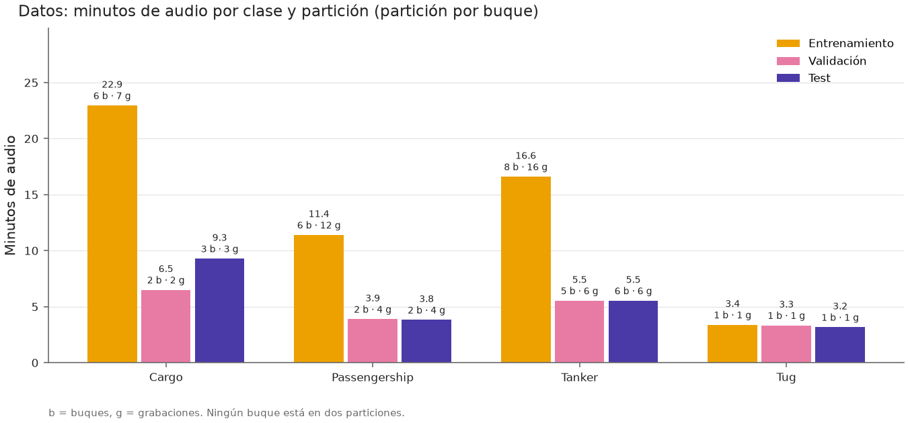

**Las cuatro clases de buque:**

- **Cargo:** buque de carga (portacontenedores, graneleros). Grande, con motor diésel lento y
  hélice grande.
- **Passengership:** buque de pasaje; en este subconjunto son sobre todo transbordadores (ferris).
- **Tanker:** petrolero o buque cisterna, que transporta líquidos a granel.
- **Tug:** remolcador. Pequeño pero muy potente; empuja o arrastra a otros barcos.

**Entrenamiento, validación y test.** Con *entrenamiento* aprende el modelo; con *validación* se
eligen sus ajustes; *test* se reserva para medir el resultado final sin haberlo usado antes. La
partición se hace **por buque**: si el mismo barco estuviera en entrenamiento y en test, el
modelo podría reconocer *ese barco concreto* en vez de su tipo, y el resultado saldría inflado.

**Cómo se lee.** Cada barra son minutos de audio; encima, `b` es el número de buques y `g` el de
grabaciones. Destacan el desequilibrio (Cargo tiene mucho más audio que el resto) y que Tug solo
tiene 3 buques. La figura muestra la partición fija de las rondas 1 y 2; en la ronda 3 cada
buque pasa por entrenamiento, validación y test (ver su protocolo).

### 2. Señal: qué son LOFAR y DEMON

Un sonar pasivo no emite nada: solo escucha con un hidrófono el ruido que radia el barco. Ese
ruido lleva dos tipos de información, y cada técnica extrae uno:

- **LOFAR** (*Low Frequency Analysis and Recording*) muestra qué frecuencias suenan y cómo
  evolucionan en el tiempo. Sirve para ver las **líneas tonales**: sonidos de frecuencia fija que
  produce la maquinaria (motor, generadores, bombas).
- **DEMON** (*Detection of Envelope Modulation On Noise*): la hélice produce un ruido ancho por
  **cavitación** (burbujas que colapsan), y ese ruido "late" al ritmo de la hélice. DEMON mide a
  qué ritmo late, lo que revela la velocidad del eje y el número de palas.

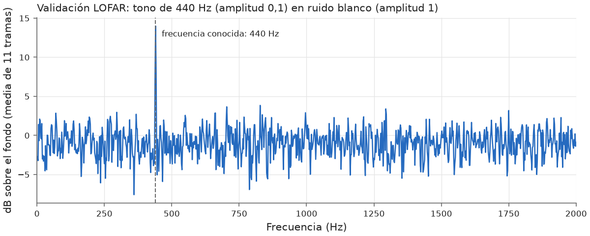
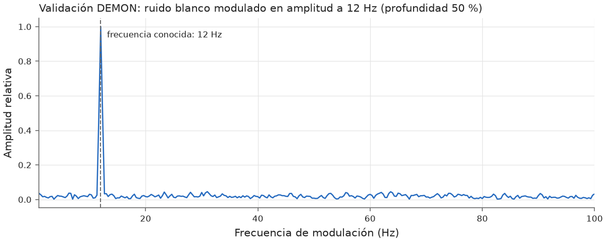

**Qué significan 440 Hz y 12 Hz.** Son pruebas con señales sintéticas cuya respuesta se conoce de
antemano. Un tono de 440 Hz (la nota *la*) escondido en ruido debe aparecer como un pico justo
en 440 Hz en el LOFAR, lo que comprueba que el eje de frecuencias es correcto. Un ruido que
"late" 12 veces por segundo, como lo haría una hélice, debe dar un pico en 12 Hz en el DEMON. La
línea discontinua marca la frecuencia conocida: si el pico cae sobre ella, el procesado es
fiable.

### 3. Un buque real

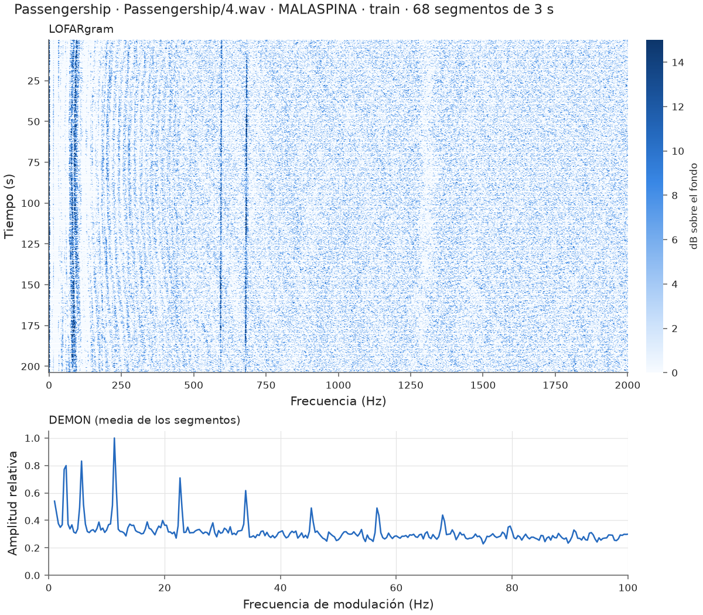

Grabación de entrenamiento de un Passengership (el MALASPINA).

- **LOFARgram (arriba).** En horizontal, la frecuencia (0 a 2000 Hz); en vertical, el tiempo
  hacia abajo; el color indica cuánto sobresale cada frecuencia del ruido de fondo, en dB. Las
  **líneas verticales** son líneas tonales: frecuencias que se mantienen en el tiempo (aquí,
  hacia 80, 594 y 682 Hz) y que funcionan como una "huella" de la maquinaria del barco.
- **DEMON (abajo).** En horizontal, la frecuencia de modulación (0 a 100 Hz). El pico hacia
  2,8-3 Hz y su doble (5,7 Hz) son el **ritmo del eje** (unas 170-180 vueltas por minuto). La
  serie cada 11,3 Hz (11,3, 22,7, 34, 45,3...) es el **paso de pala** y sus **armónicos**: un
  armónico es un múltiplo entero de una frecuencia base. Como 11,3 / 2,8 ≈ 4, sugiere una hélice
  de **4 palas**.

Estos son los rasgos que un clasificador debería aprender para distinguir buques: qué líneas
tonales tiene cada barco y a qué ritmo late su hélice.

## Ronda 3 (F5): la evaluación principal

La ronda 3 compara **7 modelos**: la línea base y, sin y con aumento de datos, una CNN, un
transformer y un híbrido CNN + transformer. **Todos se entrenan desde cero** con estos datos:
ninguno está preentrenado. El diseño completo se fijó por escrito **antes de ver ningún
resultado** ([D-024](DECISIONS.md) y sus ajustes).

> ⚠️ **Resultados provisionales.** En esta versión, el transformer y el híbrido (sin y con
> aumento) entrenaron con un *learning rate* máximo de 4,1e-4 en lugar de los 5e-4 declarados,
> por un fallo del calentamiento que encontró la revisión del código: el lr subía bien durante
> las 5 épocas de calentamiento, pero al terminarlas se quedaba en el 82 % en vez de pasar al
> 100 %. La CNN y la línea base no tienen calentamiento y no se ven afectadas. No es una fuga:
> test no intervino en nada. La ronda se reentrenará con el fallo corregido (F5-T10), y esos
> resultados sustituirán a estos, que se conservarán como histórico. Como el reentrenamiento se
> hace **después de haber visto test**, se declara igual que la ronda 2: es un arreglo de
> implementación decidido por la revisión del código, no por las cifras
> ([ajuste 3 de D-024](DECISIONS.md)).

### Protocolo: validación cruzada 5 × 5

Los 43 buques se reparten al azar en 5 grupos por clase, con buques enteros y minutos
equilibrados. En cada vuelta, un grupo es test, otro validación y los otros tres entrenamiento
(60/20/20), y se rota hasta que cada buque ha estado una vez en test. Se repite 5 veces con
repartos distintos: **25 particiones**, y cada buque de Cargo, Passengership y Tanker cae en test
5 veces. Tug solo tiene 3 buques, así que en todas las particiones va 1 a test, 1 a validación y
1 a entrenamiento, y cada Tug cae en test 8 o 9 veces (ajuste 1 de D-024).

- **Elección:** cada modelo prueba sus configuraciones con la semilla 0 en las 25 particiones y
  se queda con la de mejor F1 medio de **validación**. Test no interviene en ninguna elección.
- **Modelo final:** la configuración elegida, con 3 semillas por partición; se promedian sus
  probabilidades.
- **Comparación:** con el F1 macro de test de cada partición y la prueba t corregida de Nadeau y
  Bengio, que tiene en cuenta que las particiones comparten buques. Hay 13 comparaciones fijadas
  de antemano, con corrección de Holm por hacerlas a la vez.

**Por qué así (literatura):**

| Referencia | Qué aporta a esta decisión |
|---|---|
| Kohavi (1995) | La validación cruzada estratificada es el método recomendado para elegir modelo; 10 folds es el estándar clásico. Aquí se usan 5 para poder repartir entrenamiento, validación y test 60/20/20 y que Tug (3 buques) quede siempre en entrenamiento. |
| Dietterich (1998) | Comparar algoritmos exige repetir con particiones distintas (prueba 5×2cv), porque mide la variación debida a qué datos tocan en entrenamiento. |
| Bouckaert y Frank (2004) | Un resultado es poco replicable si depende de la partición concreta; proponen repetir la validación cruzada (10×10). |
| Kim (2009) | Con el mismo cómputo, la validación cruzada repetida estima mejor que el *hold-out* repetido (Monte Carlo) y que el bootstrap: por eso rotar y no solo sortear particiones. |
| Bengio y Grandvalet (2004) | La varianza de la validación cruzada se subestima si se tratan los folds como independientes. |
| Nadeau y Bengio (2003) | Prueba t corregida para remuestreo, que tiene en cuenta ese solapamiento: la que se usa para comparar modelos. |
| Varma y Simon (2006) | Elegir hiperparámetros e informar con la misma validación es optimista: aquí se elige con validación y se informa con test, que no interviene en la elección. |
| Bouthillier et al. (2021) | La variación por partición de los datos pesa más que la de la semilla: más particiones antes que más semillas. |
| Hashemi et al. (2026), *UniqueShip* | En sonar pasivo hay que partir por buque; usan 5 repeticiones con buques disjuntos, y al quitar las fugas en DeepShip el F1 cae de ~0,70 a ~0,56. |

Referencias:

- Kohavi, R. (1995). A study of cross-validation and bootstrap for accuracy estimation and model
  selection. *IJCAI*, 1137-1145. [dblp](https://dblp.uni-trier.de/rec/conf/ijcai/Kohavi95.html)
- Dietterich, T. G. (1998). Approximate statistical tests for comparing supervised classification
  learning algorithms. *Neural Computation*, 10(7), 1895-1923.
  [Semantic Scholar](https://www.semanticscholar.org/paper/Approximate-Statistical-Tests-for-Comparing-Dietterich/22f0579f212dfb568fbda317cba67c8654d84ccd)
- Bouckaert, R. R. y Frank, E. (2004). Evaluating the replicability of significance tests for
  comparing learning algorithms. *PAKDD*, LNCS 3056.
  [Springer](https://link.springer.com/chapter/10.1007/978-3-540-24775-3_3)
- Kim, J.-H. (2009). Estimating classification error rate: Repeated cross-validation, repeated
  hold-out and bootstrap. *Computational Statistics & Data Analysis*, 53(11), 3735-3745.
  [RePEc](https://ideas.repec.org/a/eee/csdana/v53y2009i11p3735-3745.html)
- Bengio, Y. y Grandvalet, Y. (2004). No unbiased estimator of the variance of K-fold
  cross-validation. *JMLR*, 5, 1089-1105.
  [JMLR](https://www.jmlr.org/papers/volume5/grandvalet04a/grandvalet04a.pdf)
- Nadeau, C. y Bengio, Y. (2003). Inference for the generalization error. *Machine Learning*,
  52, 239-281. [Springer](https://link.springer.com/content/pdf/10.1023/a:1024068626366.pdf)
- Varma, S. y Simon, R. (2006). Bias in error estimation when using cross-validation for model
  selection. *BMC Bioinformatics*, 7, 91.
  [resumen](https://transferlab.ai/refs/varma_bias_2006/)
- Bouthillier, X. et al. (2021). Accounting for variance in machine learning benchmarks.
  *MLSys*.
  [MLSys](https://proceedings.mlsys.org/paper_files/paper/2021/file/0184b0cd3cfb185989f858a1d9f5c1eb-Paper.pdf)
- Hashemi, C., Stout, T., Hoogs, A. y Parham, J. (2026). UniqueShip: Mitigating data leakage in
  acoustic ship classification benchmark datasets. arXiv:2609.13659.
  [arXiv](https://arxiv.org/html/2609.13659)

### Los modelos por dentro

Todos los modelos ven lo mismo de cada segmento de 3 s: el **LOFARgram** (11 instantes × 1001
frecuencias de 2 Hz, de 0 a 2000 Hz) y el **DEMON** (301 frecuencias de modulación, de 0 a
100 Hz). Antes de entrar en una red, cada entrada se normaliza con la media y la desviación de
**su partición de entrenamiento**; esos dos números se guardan con los pesos.

#### Línea base: regresión logística

Ve un resumen de cada segmento: el LOFAR promediado en el tiempo y el DEMON, 1302 números, cada
uno estandarizado. Aprende un peso por número y clase (5212 parámetros) y da la probabilidad de
cada clase. `C` es la inversa de la regularización: cuanto más pequeño, más se frenan los pesos
para que no memoricen. Usa pesos por clase para compensar el desequilibrio.

#### CNN: dos ramas convolucionales (D-018)

Una **red convolucional** aprende pequeños filtros que recorren la entrada buscando patrones
locales, como una línea tonal o un pico de modulación, estén donde estén.

```
LOFARgram 11 × 1001 ─► 3 bloques 2D ─► media en el tiempo ─► 8 posiciones ─┐
DEMON 301 ───────────► 2 bloques 1D ───────────────────────► 8 posiciones ─┴► cabeza ─► 4 clases
```

- **Bloque convolucional:** convolución → **BatchNorm** → **LeakyReLU** → *max pooling*.
  - **BatchNorm** normaliza la salida de cada filtro con la media y la desviación del minibatch.
    Estabiliza y acelera el entrenamiento.
  - **LeakyReLU** es la no linealidad: deja pasar los valores positivos y multiplica los
    negativos por 0,01, para que ninguna neurona quede "muerta" del todo.
  - El *max pooling* se queda con el máximo de cada grupo de frecuencias, solo a lo largo de la
    frecuencia. Reduce el tamaño y tolera pequeños desplazamientos.
- **Rama LOFAR:** filtros de 3 instantes × 7, 5 y 3 frecuencias, con 16, 32 y 64 filtros
  (configuración A). La frecuencia se reduce de 1001 a 250, 62 y 31 posiciones. Después se hace
  la media en el tiempo y se agrupa en 8 posiciones de frecuencia.
- **Rama DEMON:** dos bloques 1D de 16 y 32 filtros (núcleos de 7 y 5); 301 → 75 → 18 → 8
  posiciones.
- **Cabeza:** une las dos ramas (768 números) → *dropout* → capa lineal de 64 → LeakyReLU →
  *dropout* → 4 clases. El **dropout** apaga al azar una fracción de las neuronas en cada paso de
  entrenamiento, para que la red no dependa de ninguna en concreto.
- Tamaño: 79 076 parámetros y 75,3 MFLOPs por segmento (millones de operaciones de coma flotante
  para clasificar un segmento: mide el coste de cálculo).

#### Transformer: bandas de frecuencia como palabras

Un **transformer** trata la entrada como una secuencia de **tokens** (como las palabras de una
frase) y aprende, con la **atención**, qué tokens deben mirar a qué otros. Aquí cada token es una
banda de frecuencia: el modelo puede relacionar, por ejemplo, una línea a 50 Hz con su armónico
a 100 Hz aunque estén lejos.

```
LOFARgram ─► 50 bandas de 40 Hz (11 × 20 valores) ─► lineal ─┐
DEMON ─────► lineal ──────────────────────────────────────────┼► [clase, DEMON, 50 bandas] = 52 tokens
token de clase (aprendido) ───────────────────────────────────┘
      ─► N bloques transformer ─► RMSNorm ─► token de clase ─► dropout ─► lineal ─► 4 clases
```

- **Tokens:** el LOFARgram se corta en 50 bandas de 40 Hz (20 frecuencias × 11 instantes = 220
  valores; se descarta la última frecuencia, la de 2000 Hz). Una capa lineal convierte cada banda
  en un vector de tamaño `dim` (32 o 64). El DEMON entero es un token más. El **token de
  clase** es un vector que se aprende; no viene de la entrada, y su salida es la que decide la
  clase, porque por la atención "resume" a todos los demás.
- **Bloque transformer (pre-norm):**

  ```
  x = x + Dropout(Atención(RMSNorm(x)))
  x = x + SwiGLU(RMSNorm(x))
  ```

  Las sumas son **conexiones residuales**: cada bloque añade una corrección a lo que ya había,
  lo que facilita entrenar. *Pre-norm* significa que se normaliza antes de cada parte, la forma
  más estable.
- **RMSNorm:** divide cada token por la raíz de la media de sus valores al cuadrado y lo
  multiplica por una ganancia aprendida. Es más simple que LayerNorm (no resta la media) y
  funciona igual de bien.
- **Atención:** cada token produce una *consulta* (qué busca), una *clave* (qué ofrece) y un
  *valor* (qué aporta). El parecido entre consulta y clave, normalizado con *softmax*, decide
  cuánto toma cada token de los valores de los demás. Hay varias **cabezas** que lo hacen en
  paralelo, cada una pudiendo fijarse en una relación distinta.
- **RoPE** (*rotary position embedding*): sin información de posición, la atención no sabría qué
  banda es cuál. RoPE **gira** las consultas y las claves un ángulo proporcional a la posición de
  la banda (0 a 49), y así el parecido entre dos bandas depende de **su distancia en
  frecuencia**: la misma relación vale a 100 Hz que a 1000 Hz. El DEMON y el token de clase no
  tienen posición en frecuencia y no se giran. (Un test comprueba que el resultado solo depende
  de la distancia.)
- **GQA** (*grouped-query attention*): las cabezas comparten las claves y los valores por grupos.
  Con 4 cabezas y 2 grupos, cada pareja de cabezas usa las mismas claves y valores. Ahorra
  memoria y cálculo; con tantos grupos como cabezas es la atención clásica (también lo comprueba
  un test). Con estos datos no mejora la precisión: se incluyó, a petición de David, para que el
  modelo escale a un dataset mayor sin cambiar el código.
- **SwiGLU:** la red que procesa cada token tras la atención: `W_down(SiLU(x·W_gate) ⊙ (x·W_up))`.
  Una rama decide cuánto deja pasar (la "puerta", con la activación SiLU) de lo que calcula la
  otra. Su tamaño interno es unas 8/3 veces `dim` (88 con `dim` 32 y 176 con 64): así tiene los
  mismos parámetros que la red clásica de 4 × `dim`.
- **Tamaño de la configuración elegida (B):** `dim` 64, 1 bloque, 4 cabezas y 2 grupos. Tiene
  80 068 parámetros y cuesta 6,9 MFLOPs por segmento, 11 veces menos que la CNN.

#### Híbrido: la CNN como extractor y el transformer encima

Une lo mejor de cada uno: la CNN detecta patrones locales (líneas, picos) y el transformer los
relaciona entre sí a lo largo de la frecuencia.

```
LOFARgram ─► 2 primeros bloques de la CNN (16 y 32 filtros) ─► media en el tiempo
          ─► 62 posiciones de frecuencia × 32 canales ─► lineal ─► 62 tokens ─┐
DEMON ─────► rama 1D de la CNN (16 y 32 filtros) ─► 8 posiciones ─► lineal ─► 1 token ─┼► 64 tokens
token de clase ───────────────────────────────────────────────────────────────────────┘
      ─► bloques transformer como los del transformer ─► token de clase ─► 4 clases
```

- Cada token de frecuencia cubre unos 32 Hz: es la salida de la CNN en esa posición, que ya
  "ve" una zona algo más ancha por los filtros.
- RoPE gira estos 62 tokens según su posición en frecuencia; el DEMON y la clase, no.
- Configuración elegida sin aumento: B (`dim` 64, 1 bloque, 4 cabezas, 2 grupos), con 76 132
  parámetros y 57,3 MFLOPs. Con aumento: A (`dim` 32, 1 bloque, 2 cabezas, 1 grupo), con 32 036
  parámetros. Con un solo grupo, todas las cabezas comparten claves y valores: es el caso
  extremo de GQA, llamado *multi-query attention*.

#### Cómo se entrena (igual en las tres redes)

| Técnica | Qué hace | Valor |
|---|---|---|
| **AdamW** | Optimizador que adapta el paso de cada peso según la historia de sus gradientes, con el *weight decay* separado del gradiente | betas 0,9 y 0,999 |
| ***Weight decay*** | Empuja los pesos hacia 0 en cada paso, para que no crezcan solo para memorizar | Según la configuración; nunca en sesgos, normalizaciones ni el token de clase |
| **Minibatches** | Cada paso usa 32 segmentos barajados (con un generador fijo: mismo orden con y sin aumento) | 32 |
| **Pérdida con pesos por clase** | Entropía cruzada que pesa más las clases con menos segmentos | Pesos de la partición de entrenamiento |
| **Calentamiento del lr** (solo transformer e híbrido) | El *learning rate* sube en línea recta desde el 10 % durante las primeras épocas (ver abajo por qué solo en estas dos redes) | 5 épocas |
| **Decaimiento del lr** (*ReduceLROnPlateau*) | Si el F1 de validación pasa 3 épocas sin mejorar, en la siguiente divide el lr por 2 (en transformer e híbrido, tras el calentamiento) | × 0,5 |
| **Parada temprana** | Para si el F1 de validación no mejora en 10 épocas y se queda con los pesos de la mejor época | Hasta 60 épocas |
| **Aumento de datos** (versiones "+ aum.") | Solo en entrenamiento, cada cosa con probabilidad 0,5: tapar 1-2 bandas del LOFAR (hasta 100 Hz), tapar 1-2 instantes, desplazar 1-2 instantes en círculo y tapar una banda del DEMON (hasta 3,3 Hz). Se tapa con la media de entrenamiento | Generador propio |
| **Determinismo** | Semillas fijas, algoritmos deterministas y 4 hilos de CPU: el mismo entrenamiento da los mismos pesos bit a bit en el mismo tipo de dispositivo | — |

**Por qué el transformer y el híbrido tienen calentamiento y la CNN no:**

- Al empezar, los pesos son aleatorios y AdamW todavía no tiene una buena estimación de cuánto
  varía cada gradiente: sus primeros pasos son grandes y poco fiables (Liu et al., 2020, el
  artículo de RAdam).
- En un transformer eso es especialmente peligroso, porque la atención usa un *softmax*: un
  paso grande al principio puede hacer que cada token se fije solo en otro y se quede
  "atascado". Por eso el transformer original (Vaswani et al., 2017) y casi todos los
  posteriores usan calentamiento. El híbrido lo lleva por su parte de transformer.
- La CNN tiene BatchNorm después de cada convolución (Ioffe y Szegedy, 2015), que estabiliza
  las activaciones desde la primera época, y no tiene *softmax* internos. Las CNN se entrenan
  bien sin calentamiento, y es lo habitual.
- Además, la CNN de la ronda 3 (configuración A) tenía que ser la misma que la de las rondas 1
  y 2, que no tenía calentamiento: si se lo hubiéramos añadido, no sabríamos si un cambio en el
  resultado venía del 5 × 5 o del calentamiento.

Referencias:

- Vaswani, A. et al. (2017). Attention is all you need. *NeurIPS*.
  [arXiv](https://arxiv.org/abs/1706.03762)
- Liu, L. et al. (2020). On the variance of the adaptive learning rate and beyond. *ICLR*.
  [arXiv](https://arxiv.org/abs/1908.03265)
- Ioffe, S. y Szegedy, C. (2015). Batch normalization: Accelerating deep network training by
  reducing internal covariate shift. *ICML*. [arXiv](https://arxiv.org/abs/1502.03167)

### Por qué cada configuración

Cada red prueba 4 configuraciones, fijadas antes de entrenar. Cada una responde a una pregunta
concreta: **¿qué falla, la capacidad o la regularización?** En F3 las CNN memorizaban
(entrenamiento casi perfecto, validación pobre). La primera configuración es siempre la más
simple, y en caso de empate gana ella. La versión sin aumento y la versión con aumento eligen por
separado. Abajo, el F1 medio de validación de cada configuración en las 25 particiones (en
negrita, la elegida); la figura de elección es
[docs/figures/round3/round3_selection.png](docs/figures/round3/round3_selection.png).

**Línea base: C ∈ {0,001; 0,01; 0,1; 1; 10}** (A a E). Es la rejilla clásica de 5 órdenes de
magnitud, de muy regularizado a casi libre. La de F3 eligió C = 10.

| A (0,001) | B (0,01) | C (0,1) | D (1) | E (10) |
|---|---|---|---|---|
| 0,312 | 0,315 | 0,316 | 0,318 | **0,337** |

Ganó E, el borde de la rejilla, como en F3. Pero todas están dentro de ±0,09 de desviación entre
particiones, así que la regularización apenas cambia el resultado. Con C = 10 la línea base
acierta el 100 % de entrenamiento y es el modelo peor calibrado (ECE 0,45; el ECE, *expected
calibration error*, mide cuánto se aleja la confianza del modelo de su acierto real: 0 es
perfecto).

**CNN** (lr 1e-3, `wd` 1e-2 y dropout 0,3 salvo que se diga otra cosa):

| Config. | Qué cambia | Hipótesis que prueba | CNN | CNN + aum. |
|---|---|---|---|---|
| A | Nada: es la CNN de las rondas 1 y 2 (16-32-64 / 16-32 filtros) | Referencia | 0,396 | 0,397 |
| B | La mitad de filtros (8-16-32 / 8-16) | ¿Sobra capacidad y por eso memoriza? | 0,369 | 0,380 |
| C | Más regularización: dropout 0,5 y `wd` 5e-2 | ¿Falta freno? | **0,399** | 0,390 |
| D | lr 3e-4 | En F3 lo mejor llegaba en las épocas 3-10: ¿aprende demasiado deprisa? | 0,380 | **0,398** |

Reducir la capacidad (B) empeora; más regularización (C) y un lr menor (D) dan lo mismo que A.
Las diferencias (≤ 0,03) son mucho menores que la desviación entre particiones (~0,10): **es
casi un empate**, y lo que limita a la CNN no es ninguno de estos ajustes, sino los pocos
buques.

**Transformer e híbrido** (las mismas 4; lr 5e-4 y `wd` 5e-2, valores habituales en
transformers pequeños con AdamW, que necesitan más *weight decay* que una CNN):

| Config. | `dim`, bloques, cabezas / grupos, dropout | Hipótesis que prueba | Transformer | Transf. + aum. | Híbrido | Híbrido + aum. |
|---|---|---|---|---|---|---|
| A | 32, 1, 2 / 1, 0,3 | Lo mínimo: con tan pocos datos, quizá basta | 0,284 | 0,302 | 0,400 | **0,403** |
| B | 64, 1, 4 / 2, 0,3 | ¿Hace falta más anchura por token? | **0,324** | **0,325** | **0,406** | 0,376 |
| C | 64, 2, 4 / 2, 0,3 | ¿Ayuda un segundo bloque, que relacione las bandas en dos pasos? | 0,310 | 0,319 | 0,385 | 0,387 |
| D | Como C, con dropout 0,5 | Si la profundidad memoriza, ¿la compensa más dropout? | 0,304 | 0,314 | 0,357 | 0,376 |

El transformer prefiere más anchura (B). El segundo bloque (C) no ayuda en ninguna red, y añadirle
dropout (D) tampoco. El híbrido se queda con un solo bloque: B sin aumento y A con aumento, a
menos de 0,03 de distancia. Otra vez, las diferencias entre configuraciones son mucho menores
que la variación entre particiones.

### Resultados de la ronda 3 en gráficas

Las 15 gráficas acordadas, con su explicación y todas las cifras, están en el informe
([docs/report.md](docs/report.md#4-ronda-3-f5-validación-cruzada-5--5--evaluación-principal)).
Aquí van las principales. Cada figura indica en su título que es de la ronda 3.

#### 4. Resultados en test

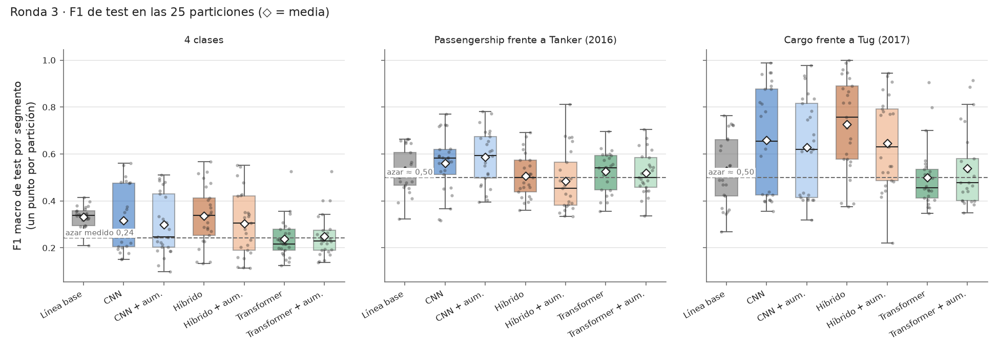

**Cómo se lee.** Hay una caja por modelo con sus **25 F1 de test**, uno por partición (los puntos
grises). La caja va del primer al tercer cuartil, la raya es la mediana y el rombo blanco la
media. La línea discontinua es el **azar**: medido con 4 clases (0,24) y aproximado a 0,5
dentro de cada época, donde solo hay 2 clases. Los paneles de la derecha comparan solo clases
**grabadas en la misma época**: es lo que mejor mide la firma del buque, porque en esas parejas
las condiciones de grabación son las mismas.

**Qué se ve.**

- Con 4 clases, la línea base (0,331), la CNN (0,316) y el híbrido (0,343) quedan cerca. El
  transformer (0,235) queda **en el azar**.
- **La altura de las cajas es lo más importante:** las redes van de ~0,1 a ~0,58 según qué
  buques les toquen en test. Una sola partición, como en las rondas 1 y 2, podía dar casi
  cualquier cifra; por eso se hizo el 5 × 5.
- **Cargo frente a Tug (2017):** el híbrido (0,71) y la CNN (0,66) están por encima del 0,5 de
  media, pero sus cajas bajan hasta el azar en muchas particiones. Además, Tug solo tiene 3
  buques: no basta para afirmar que reconozcan la firma del buque.

#### Comparaciones entre modelos

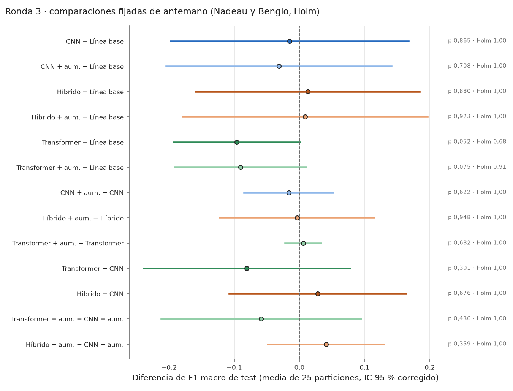

**Cómo se lee.** Cada fila es la diferencia media de F1 entre dos modelos en las mismas 25
particiones, con su **intervalo del 95 %** corregido por Nadeau y Bengio (que tiene en cuenta que
las particiones comparten buques). Si el intervalo cruza la línea del 0, la diferencia no se
distingue del ruido. A la derecha, el p sin corregir y con Holm.

**Qué se ve.** **Ninguna de las 13 diferencias es significativa.** Todos los intervalos cruzan el
0; el del transformer frente a la línea base lo cruza por muy poco (−0,096, de −0,193 a +0,001,
p = 0,052), y tras Holm
nada se acerca (p ≥ 0,68). El aumento de datos tampoco cambia nada en ninguna arquitectura
(diferencias de −0,017 a +0,006).

#### Precisión frente a coste

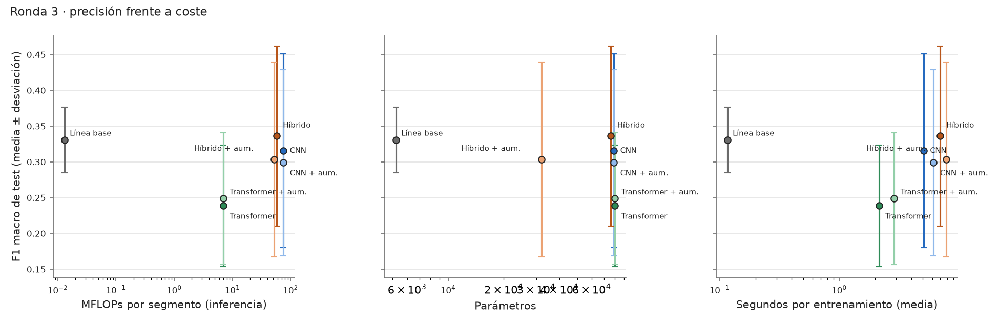

**Cómo se lee.** El F1 medio (± desviación) de cada modelo frente a su coste: operaciones por
segmento, número de parámetros y segundos de entrenamiento, en escala logarítmica. Un modelo
más caro solo compensa si sube.

**Qué se ve.** La línea base, con 5212 parámetros y unas 13 000 operaciones por segmento (5800
veces menos que la CNN), rinde igual que las redes y varía mucho menos. El transformer es el más
barato de las redes (6,9 MFLOPs) y el peor.

#### Matrices de confusión

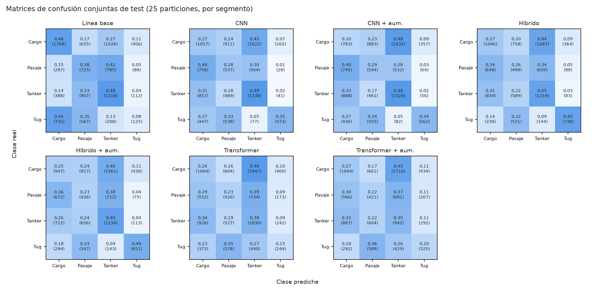

**Cómo se leen.** Juntan todas las predicciones de test de las 25 particiones; cada segmento
cuenta 5 veces, una por repetición. Las filas son la clase real y las columnas la predicha; la
diagonal son los aciertos.

**Qué se ve.** Todas las redes predicen mucho **Tanker** (de 0,41 a 0,49 de los Cargo acaban ahí)
y confunden Passengership con Cargo y Tanker. El híbrido es el que más acierta Tug (0,47). La
línea base acierta sobre todo Cargo y Tanker, pero manda casi la mitad de los Tug a Cargo, la otra clase
de 2017: encaja con aprender la época más que el buque.

#### Qué frecuencias usa cada modelo

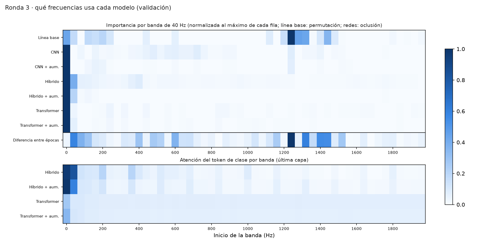

**Cómo se lee.** Arriba, una fila por modelo: cuánto depende de cada banda de 40 Hz, normalizado
al máximo de la fila. En la línea base es la caída de F1 al desordenar la banda; en las redes, la
caída de la probabilidad de acierto al taparla. La última fila es cuánto difiere esa banda entre
las grabaciones de 2016 y las de 2017. Abajo, a qué bandas mira el token de clase del
transformer y del híbrido. Todo sobre validación.

**Qué se ve.**

- **Todas las redes dependen sobre todo de 0-40 Hz**, y el híbrido y el transformer también de
  40-80 Hz. Son frecuencias muy bajas, donde dominan el ruido del mar y de la plataforma de
  grabación más que la firma del buque. La atención del híbrido apunta a esas mismas bandas.
- **La línea base usa sobre todo 1240-1320 Hz**, y **3 de sus 5 bandas principales están entre
  las 5 que más difieren entre épocas**. Puede que parte de su resultado venga de las
  condiciones de grabación y no del buque.
- No hay líneas tonales fijas de una época, y las relaciones con la diferencia entre épocas son
  débiles y poco fiables (bandas vecinas correlacionadas).

**En resumen:** con 43 buques y la clase pegada a la época, ningún modelo, ni el más sencillo ni
el transformer, demuestra reconocer la firma del buque. El 5 × 5 deja claro que las diferencias
entre modelos son menores que lo que cambia el resultado según qué buques tocan en test. Para
avanzar hacen falta **más buques y clases grabadas en las mismas condiciones**, no modelos más
complejos.

## Rondas 1 y 2 (F3): partición fija · histórico

**Etapa anterior, no comparable directamente con la ronda 3.** Usaron una sola partición fija
(12 buques en test) y test se miró dos veces. Con una sola partición, la cifra depende mucho de
qué buques tocaron en test: la ronda 3 muestra que, según la partición, las mismas redes van
de ~0,1 a ~0,58. Se conservan como histórico; el detalle de las dos rondas y de qué código
produjo cada cifra está en [docs/results/README.md](docs/results/README.md).

### Resultados en test (ronda 2)

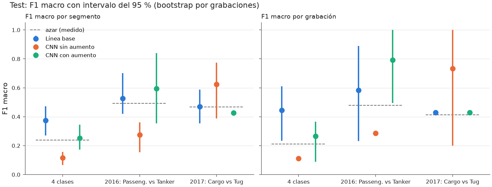

**Los tres modelos usan exactamente los mismos datos** (los mismos segmentos de 3 s y la misma
partición); solo cambia el modelo y cómo se entrena:

- **Línea base:** una regresión logística, el modelo más simple. Ve un resumen de cada segmento
  (el LOFAR promediado en el tiempo más el DEMON: 1302 números) y aprende un peso por frecuencia.
  Sirve de referencia.
- **CNN sin aumento:** una red neuronal convolucional que ve el LOFARgram completo (11 instantes
  × 1001 frecuencias) y el DEMON, y puede aprender patrones más complejos.
- **CNN con aumento:** la misma red, pero durante el entrenamiento cada segmento se altera al azar
  (se tapan bandas de frecuencia o instantes y se desplaza un poco en el tiempo) para que no lo
  memorice. Validación y test nunca se alteran.

**Ronda 1 y ronda 2.** En la ronda 1 se entrenaron los modelos y se evaluó test por primera vez.
Después, una revisión del código encontró fallos de implementación y de medida (por ejemplo, dos
de las ocho salidas de la rama DEMON de la CNN valían siempre cero). Se arreglaron **sin cambiar
nada para mejorar la cifra**, se reentrenaron las dos CNN y se evaluó test una segunda y última
vez: es la **ronda 2**, la de esta gráfica. La línea base no cambió.

**Cómo se lee.** El *F1 macro* va de 0 a 1 (1 es acertar todo) y pondera igual las cuatro clases.
Cada punto lleva su **intervalo del 95 %** (la barra vertical) y la línea discontinua es el
**azar medido** (lo que sacaría un clasificador que responde al azar). El grupo de la izquierda
usa las 4 clases; los otros dos comparan clases **grabadas en la misma época** (Cargo frente a
Tug, de 2017; Passengership frente a Tanker, de 2016), que es lo que de verdad mide la firma del
buque, porque en esas parejas las condiciones de grabación son las mismas.

**Conclusión.** Solo la línea base tiene todo su intervalo por encima del azar con 4 clases, y
dentro de cada época ningún modelo lo supera.

### Matrices de confusión (ronda 2)

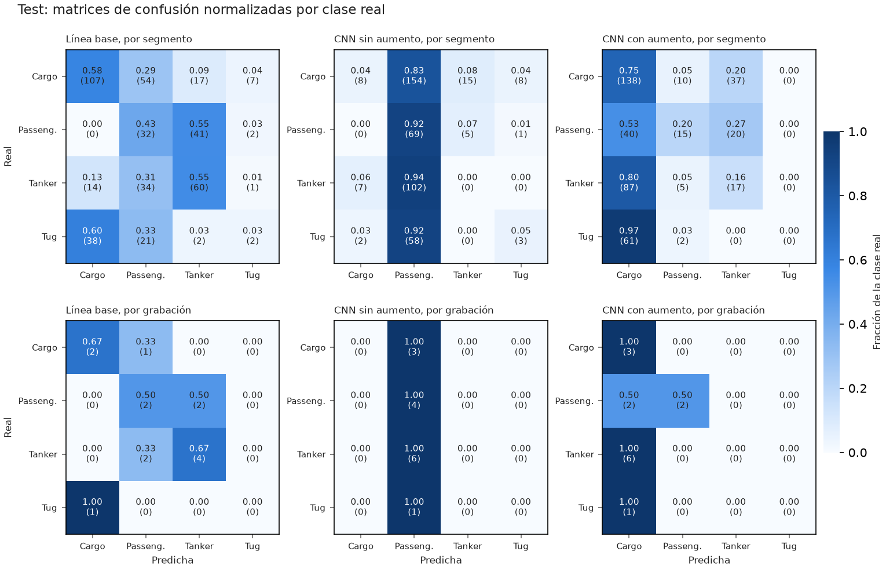

**Cómo se leen.** Las **filas** son la clase real y las **columnas**, la clase que predijo el
modelo. La **diagonal** son los aciertos. Cada número es qué fracción de esa clase real acabó en
esa columna (entre paréntesis, el recuento). Arriba, **por segmento** (cada trozo de 3 s); abajo,
**por grabación** (la media de todos sus segmentos).

**Por qué la CNN sin aumento lo predice casi todo como Passengership y la CNN con aumento casi
todo como Cargo.** Es un síntoma de que **no generalizan**, no una preferencia real por esas
clases. Con solo 43 buques, la red **memoriza los buques de entrenamiento** (su mejor resultado en
validación llega hacia la época 3 y después solo memoriza); ante buques que nunca ha visto, sus
salidas **se colapsan hacia una sola clase**. Qué clase "gana" no tiene un significado físico:
depende del azar del entrenamiento (la semilla y el aumento), y por eso cambia de una CNN a otra.
Es una explicación razonada a partir de las curvas de entrenamiento, no algo demostrado con un
experimento específico.

La **línea base** acierta sobre todo Cargo y Tanker, y confunde Tug con Cargo, dos clases grabadas en la
misma época, lo que encaja con la limitación de la época.

### Qué frecuencias usa cada modelo (ronda 2)

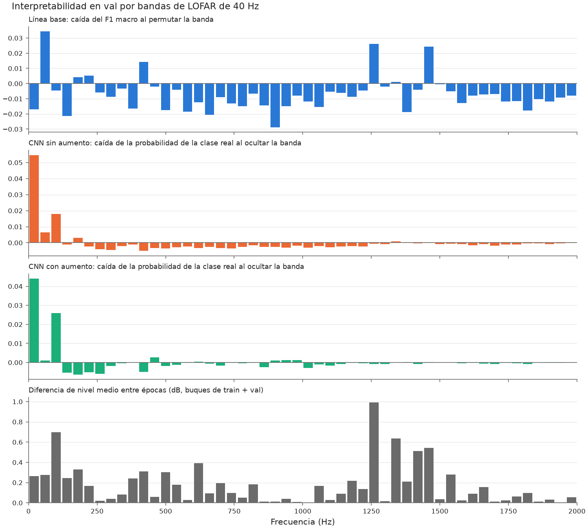

**Eje horizontal:** bandas de 40 Hz del LOFAR, de 0 a 2000 Hz. **Eje vertical, panel a panel:**

1. **Línea base:** cuánto **baja el F1** si se desordena esa banda entre segmentos (se rompe su
   relación con la clase). Cuanto más alta la barra, más depende el modelo de esa banda; los
   valores negativos o cercanos a cero indican que la banda no le sirve.
2. y 3. **Las dos CNN:** cuánto **baja la probabilidad de acertar la clase real** si se tapa esa
   banda (se rellena con el valor medio).
4. **Diferencia entre épocas:** cuánto difiere el **nivel medio de cada banda entre las
   grabaciones de 2016 y las de 2017**, en dB. Una barra alta indica una banda que delata la época
   de grabación.

**Qué se busca y qué se ve.** Si las bandas que usa un modelo coinciden con las que delatan la
época, el modelo podría estar aprendiendo la época y no el buque. La línea base usa sobre todo
40-80, 1240-1280 y 1440-1480 Hz, y **las dos últimas están entre las que más difieren entre
épocas**. Las CNN dependen sobre todo de **0-40 Hz**, frecuencias muy bajas donde dominan el ruido
del mar y de la plataforma de grabación más que la firma del buque. Todas las importancias son
pequeñas: ninguna banda decide por sí sola.

## Limitaciones

Explicadas en el informe ([docs/report.md](docs/report.md), sección 6). En resumen:

- **Clase y época coinciden** (DT-005): Cargo y Tug se grabaron en 2017, y Passengership y
  Tanker en 2016. El resultado de 4 clases no distingue el tipo de buque de las condiciones de
  grabación; solo las comparaciones dentro de una época están libres de ese efecto.
- **Pocos buques:** 43 en total, y Tug solo 3. En la ronda 3, cada Tug cae en test 8 o 9 veces,
  y el solapamiento entre particiones en esa clase es mayor del que corrige la prueba de Nadeau y
  Bengio.
- **El resultado depende mucho de la partición:** en la ronda 3 las redes varían ~0,08-0,14 de
  F1 entre particiones, y las semillas de una misma partición ~0,04-0,10.
- **La ROC es de clasificación**, no de detección: DeepShip no tiene grabaciones sin buque
  (DT-007).
- **Rondas 1 y 2:** test se evaluó dos veces (la segunda, tras arreglar los fallos de la primera
  revisión).

## Procedencia

Qué código produjo cada resultado, con su `code_sha256` y su commit:
[docs/results/README.md](docs/results/README.md). La ronda 3 se entrenó con el código del commit
`c96865f`, y su interpretabilidad con el de `8558273`.

## Equipo de referencia

Todos los tiempos y resultados de este README se midieron en:

| Componente | Detalle |
|---|---|
| CPU | Intel Core i7-14700KF (28 hilos), x86-64 |
| GPU | NVIDIA GeForce RTX 4060, 8 GB (driver 610.62; PyTorch 2.14.1 con CUDA 13.0) |
| Sistema | Windows 10 Pro con Docker Desktop (WSL2) |
| Imágenes | `sonar-pipeline:latest` (CPU, 1,9 GB) y `sonar-pipeline:gpu` (9,4 GB) |

## Carpetas

| Carpeta | Qué contiene |
|---|---|
| `datasets/` | Manifiestos versionados (`manifests/`); audios y rasgos, no (`raw/`, `processed/`). |
| `models/` | Pesos de las rondas 1 y 2 y su configuración, versionados. En `models/round3/`, los de la ronda 3: solo se versionan los representativos (`representative/`). |
| `docs/` | Informe, resúmenes de resultados y figuras, versionados (montada en el contenedor para `report`). |
| `outputs/` | Resultados y figuras de cada ejecución (en `round3/`, un JSON por entrenamiento). No se suben a git. |
| `src/sonar_pipeline/` | Código de la pipeline. |
| `tests/`, `tools/` | Tests y scripts de apoyo. |

## Licencia

El código y la documentación están bajo la licencia MIT ([LICENSE](LICENSE)), © 2026 David
Morgado Carames. No cubre los datos de DeepShip (no se distribuyen aquí) ni los pesos de
`models/`, que derivan de DeepShip y siguen su mismo supuesto de uso académico (D-022).

## Cita

Datos: Irfan, M. et al. (2021). *DeepShip: An underwater acoustic benchmark dataset and a
separability based deep learning framework for ship classification.* Expert Systems with
Applications, 183, 115270.

DeepShip no tiene licencia explícita: se asume que puede usarse con fines académicos citando a
los autores (supuesto no confirmado por ellos), y ningún audio se redistribuye. Detalles en
[datasets/README.md](datasets/README.md).
