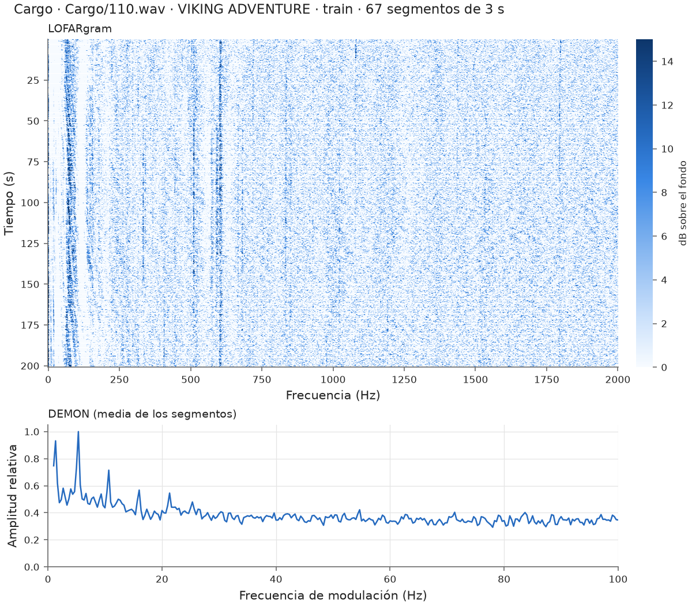
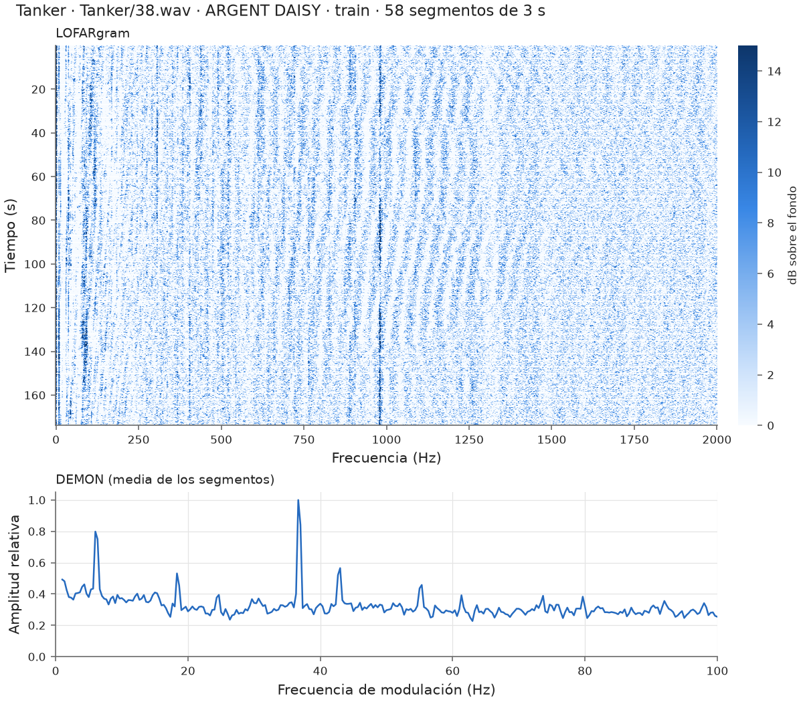
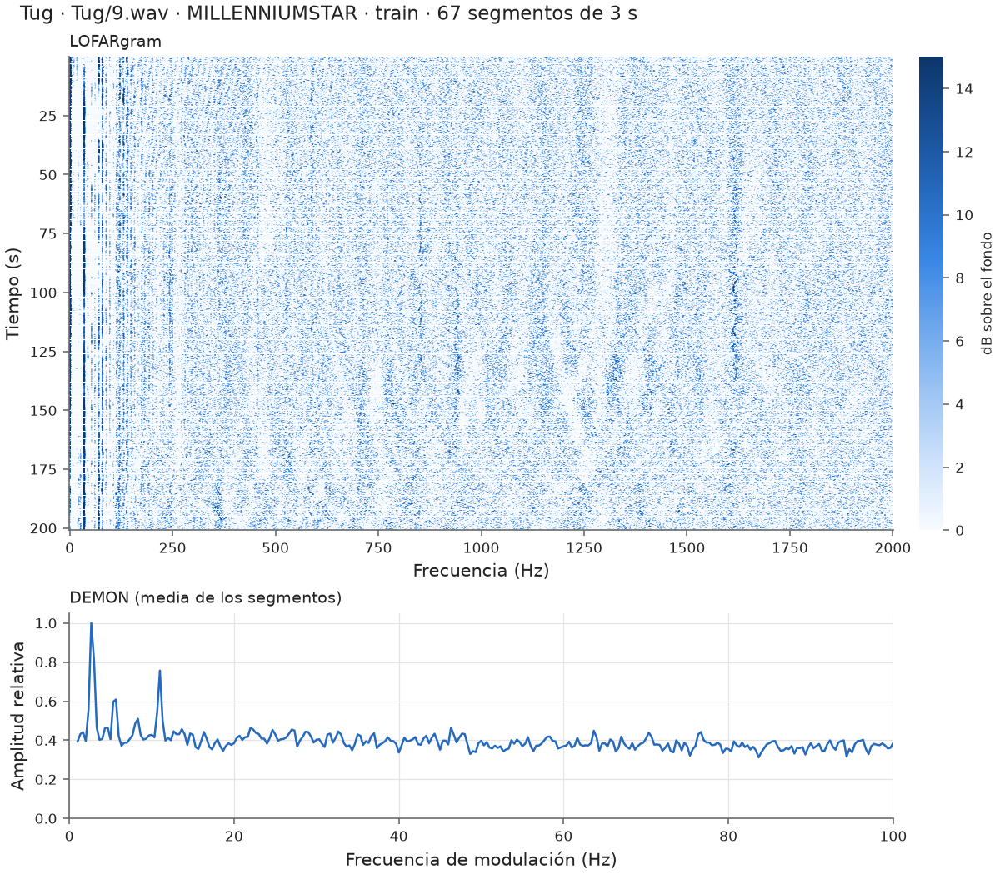
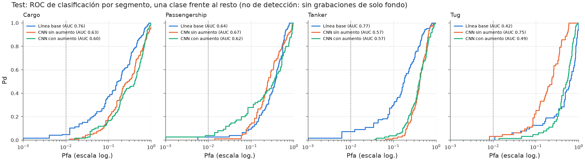
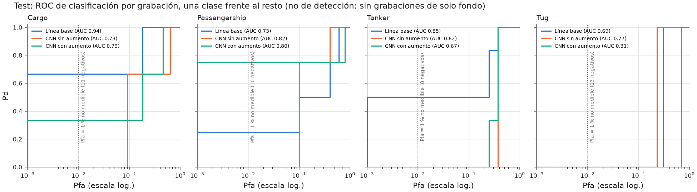
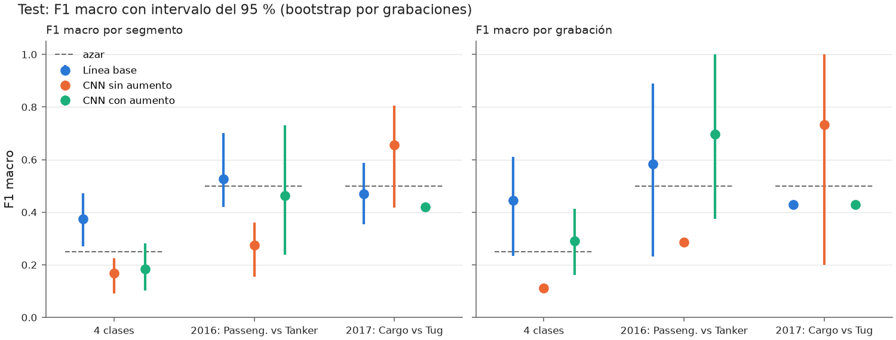
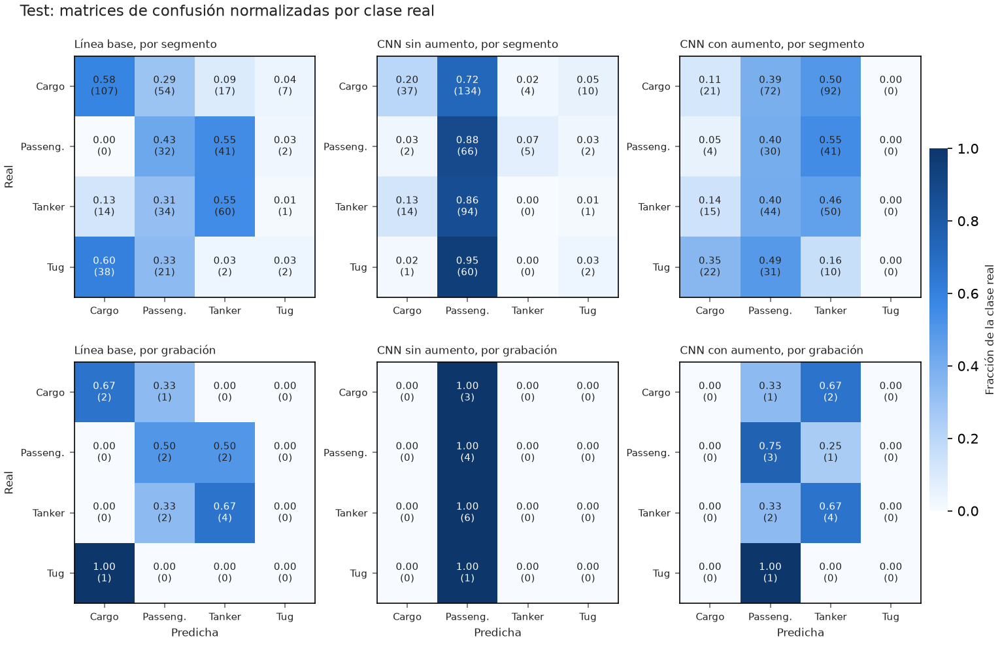
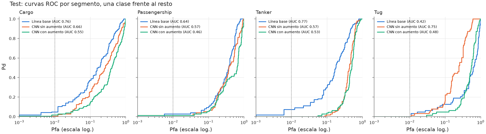
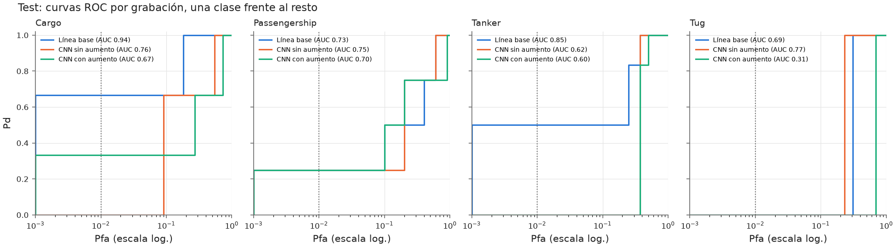
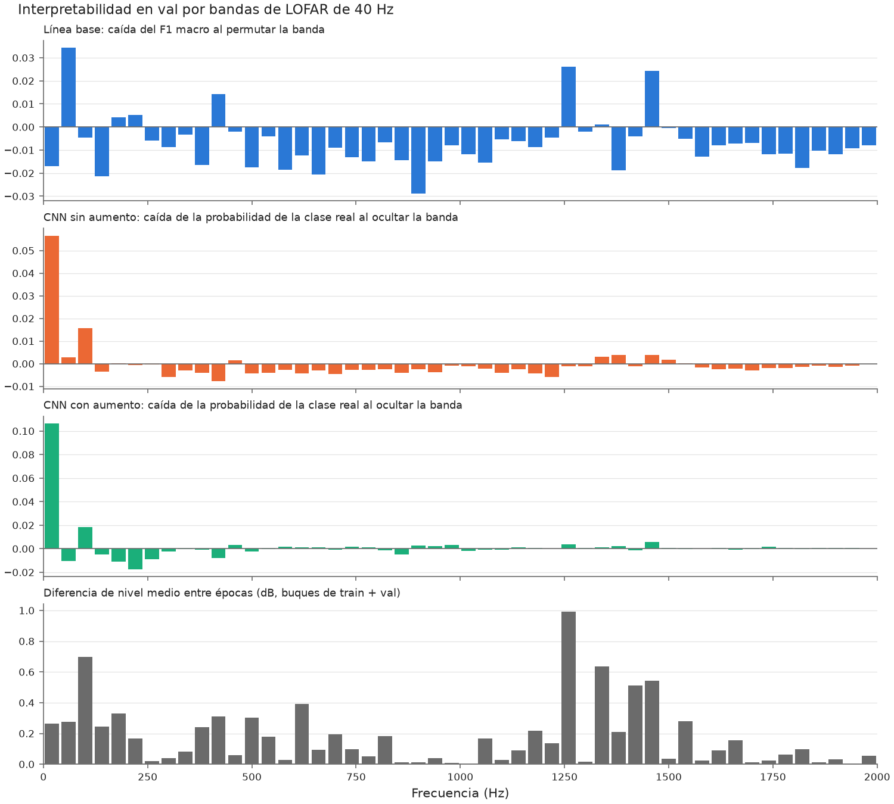

# Informe de resultados · sonar_investigacion

*Generado por `python -m sonar_pipeline report` a partir de `docs/results/` (D-020, D-021). No editar a mano.*

## Resumen

- Solo la **línea base** (regresión logística sobre LOFAR y DEMON promediados) supera al azar en test: F1 macro 0,374 frente a un azar medido de 0,238 (p = 0,040 en el test de permutación).
- Las dos CNN no generalizan: 0,115 sin aumento y 0,252 con aumento.
- Dentro de cada época de grabación (Cargo frente a Tug, Passengership frente a Tanker) ningún modelo se distingue del azar: con estos datos **no se puede afirmar que se reconozca la firma del buque** (ver Limitaciones).

## 1. Datos

Subconjunto público de DeepShip (63 grabaciones, 43 buques, 95,4 minutos de audio; 4 clases). La partición es **por buque**: ningún buque aparece en dos particiones (D-007, D-013).

| Clase | Entrenamiento | Validación | Test |
|---|---|---|---|
| Cargo | 22,9 min · 6 b · 7 g | 6,5 min · 2 b · 2 g | 9,3 min · 3 b · 3 g |
| Passengership | 11,4 min · 6 b · 12 g | 3,9 min · 2 b · 4 g | 3,8 min · 2 b · 4 g |
| Tanker | 16,6 min · 8 b · 16 g | 5,5 min · 5 b · 6 g | 5,5 min · 6 b · 6 g |
| Tug | 3,4 min · 1 b · 1 g | 3,3 min · 1 b · 1 g | 3,2 min · 1 b · 1 g |

b = buques, g = grabaciones.

## 2. Señal

Cada grabación se centra (offset DC) y se corta en segmentos de 3 s sin solapamiento, escalados a RMS = 1 (D-015).

- **LOFAR:** diezmado a 5 kHz, ventana Hann de 0,50 s con avance de 0,25 s, 0-2000 Hz (11 tramas × 1001 bins de 2 Hz), normalizado con TPSW (dB sobre el fondo).
- **DEMON:** paso banda 2000-8000 Hz, envolvente de Hilbert diezmada a 500 Hz, espectro de 0 a 100 Hz (301 bins de 1/3 Hz).

Validación con señales sintéticas: un tono de 440 Hz aparece en su bin del LOFAR y una modulación de 12 Hz en el del DEMON.

Ejemplos (la grabación de entrenamiento más larga de cada clase):

## 3. Modelos y protocolo

- **Línea base:** regresión logística estandarizada con pesos por clase; C elegido con val; validación cruzada agrupada por buque y test de permutación entre buques.
- **CNN:** dos ramas (LOFARgram 2D y DEMON 1D), unos 79 000 parámetros, AdamW, pesos por clase y parada temprana con el F1 macro de val; rejilla 2 × 2 y 3 semillas.
- **CNN con aumento:** la misma red, configuración y semillas, con enmascarado de frecuencia y tiempo y pequeños desplazamientos solo en entrenamiento.
- Todo se decide con val; test se usa solo para la evaluación final de cada ronda. La decisión por grabación es la media de las probabilidades de sus segmentos (D-018).

## 4. Resultados

F1 macro con intervalos del 95 % (bootstrap remuestreando grabaciones dentro de cada clase). Hubo **dos rondas**: la segunda tras arreglar los fallos de implementación y de medida que encontró la revisión de F3, sin cambiar nada para mejorar la cifra; test se había mirado ya en la primera. Detalle y procedencia en [docs/results/README.md](results/README.md).

### Ronda 2 (final)

Modelos versionados en `models/` (los que usa `evaluate`).

| Modelo | Val (segmento) | Val, media de semillas | Test (segmento) | Test (grabación) | Test 2016: Passeng. vs Tanker | Test 2017: Cargo vs Tug |
|---|---|---|---|---|---|---|
| Línea base | 0,381 | — | 0,374 (0,27-0,47) | 0,444 (0,23-0,61) | 0,527 (0,42-0,70) | 0,470 (0,35-0,59) |
| CNN sin aumento | 0,391 | 0,329 ± 0,069 | 0,115 (0,07-0,16) | 0,111 (0,11-0,11) | 0,276 (0,15-0,36) | 0,625 (0,39-0,77) |
| CNN con aumento | 0,358 | 0,297 ± 0,044 | 0,252 (0,17-0,34) | 0,267 (0,09-0,37) | 0,594 (0,35-0,84) | 0,427 (0,43-0,43) |
| *Azar medido* | | | *0,238* | *0,212* | *0,493* | *0,468* |

Test de permutación de la línea base (200 permutaciones de las clases entre buques; eligiendo C con val dentro de cada permutación): F1 real 0,370 frente a una media nula de 0,272 (percentil 95: 0,364); **p = 0,040**.

Interpretabilidad (sobre val):

- Línea base, bandas de LOFAR más importantes: 40-80 Hz, 1240-1280 Hz, 1440-1480 Hz, 400-440 Hz, 200-240 Hz.
- CNN sin aumento, oclusión: 0-40 Hz, 80-120 Hz, 40-80 Hz, 160-200 Hz, 1320-1360 Hz.
- CNN con aumento, oclusión: 0-40 Hz, 80-120 Hz, 440-480 Hz, 960-1000 Hz, 920-960 Hz.
- Líneas fijas de época: ninguna.
- Relación con las bandas que más difieren entre épocas: Línea base ρ = 0,29 (p = 0,039), 2/5 bandas en común; CNN sin aumento ρ = 0,27 (p = 0,055), 2/5 bandas en común; CNN con aumento ρ = 0,02 (p = 0,881), 1/5 bandas en común. Ninguno de estos p es fiable (bandas vecinas correlacionadas, sin corrección).

### Ronda 1

Primera evaluación de test, antes de los arreglos (figuras copiadas tal cual; el azar se suponía 0,25 y 0,5).

| Modelo | Val (segmento) | Val, media de semillas | Test (segmento) | Test (grabación) | Test 2016: Passeng. vs Tanker | Test 2017: Cargo vs Tug |
|---|---|---|---|---|---|---|
| Línea base | 0,381 | — | 0,374 (0,27-0,47) | 0,444 (0,23-0,61) | 0,527 (0,42-0,70) | 0,470 (0,35-0,59) |
| CNN sin aumento | 0,376 | 0,339 ± 0,028 | 0,167 (0,09-0,23) | 0,111 (0,11-0,11) | 0,276 (0,15-0,36) | 0,656 (0,42-0,81) |
| CNN con aumento | 0,536 | 0,388 ± 0,110 | 0,185 (0,10-0,28) | 0,290 (0,16-0,41) | 0,463 (0,24-0,73) | 0,421 (0,41-0,43) |
| *Azar (supuesto)* | | | *0,25* | *0,25* | *0,5* | *0,5* |

Test de permutación de la línea base (200 permutaciones de las clases entre buques; C fijo): F1 real 0,370 frente a una media nula de 0,270 (percentil 95: 0,355); **p = 0,040**.

Interpretabilidad (sobre val):

- Línea base, bandas de LOFAR más importantes: 40-80 Hz, 1240-1280 Hz, 1440-1480 Hz, 400-440 Hz, 200-240 Hz.
- CNN sin aumento, oclusión: 0-40 Hz, 80-120 Hz, 1440-1480 Hz, 1360-1400 Hz, 1320-1360 Hz.
- CNN con aumento, oclusión: 0-40 Hz, 80-120 Hz, 1440-1480 Hz, 1240-1280 Hz, 440-480 Hz.
- Líneas fijas de época: ninguna.
- Relación con las bandas que más difieren entre épocas: Línea base ρ = 0,29 (p = 0,039), 2/5 bandas en común; CNN sin aumento ρ = 0,08 (p = 0,572), 3/5 bandas en común; CNN con aumento ρ = -0,05 (p = 0,743), 3/5 bandas en común. Ninguno de estos p es fiable (bandas vecinas correlacionadas, sin corrección).

## 5. Limitaciones

- **Clase y época coinciden** (DT-005): Cargo y Tug se grabaron en 2017 y Passengership y Tanker en 2016. El resultado de 4 clases no distingue el tipo de buque de las condiciones de grabación; solo las comparaciones dentro de una época están libres de ese efecto, y ahí ningún modelo supera al azar.
- **Pocos buques:** 43 en total. Tug tiene 3 (una sola grabación en test): su resultado no es fiable, y las demás clases también tienen pocos buques.
- **La ROC es de clasificación** (una clase frente al resto), no de detección: DeepShip no tiene grabaciones de solo fondo (DT-007). La Pd a Pfa = 1 % no se puede medir con menos de 100 negativos.
- **Azar medido:** con clases desequilibradas el azar no es 0,25 exacto; se mide con un clasificador aleatorio sobre las etiquetas reales.
- **Dos evaluaciones de test:** la segunda se hizo después de ver la primera; los arreglos vinieron de la revisión del código, no de las cifras.
- La validación cruzada de la línea base mezcla folds de 3 y 4 clases (Tug falta en 3 de 5), y el C elegido (10) está en el borde de la rejilla.

## 6. Procedencia y reproducibilidad

- Qué código produjo cada resultado: tabla de procedencia en [docs/results/README.md](results/README.md).
- SHA-256 de los pesos evaluados (ronda 2): baseline `1968677ae9e5…`, cnn `bcda0f3385fd…`, cnn_aug `701214ab0c5c…`.
- Las figuras de señal se generaron con `features --figures` y los tests de figuras; las de resultados, con `evaluate` (la ronda 2 redibujada con `evaluate --plot-only`).

